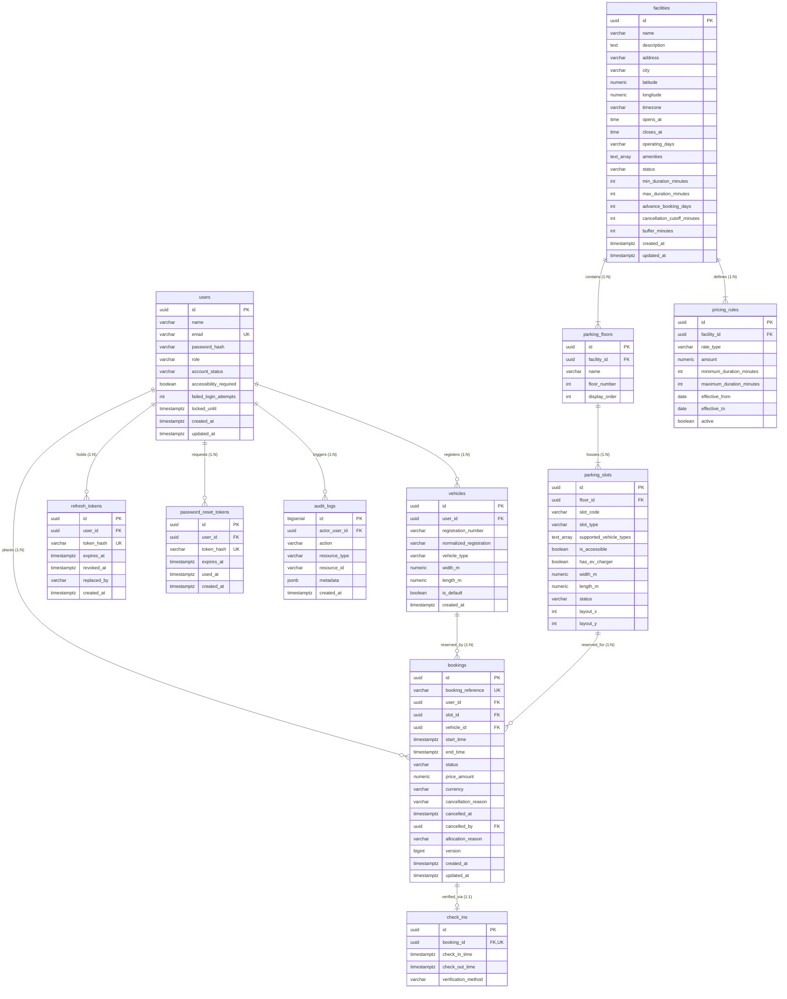

# SmartPark: Database Architecture & Schema Specification

This document provides a comprehensive catalog of the **PostgreSQL 16** relational database backing the SmartPark platform. The schema is fully version-controlled and applied via Flyway migrations.

---

## 1. Relational Summary

- **Database Engine:** PostgreSQL 16 (Alpine) running via Docker container `smartpark-postgres`.
- **Database Name:** `smartpark`
- **Application User:** `smartpark`
- **Total Tables:** **12** (11 Application Domain Tables + 1 Flyway Migration History Table).
- **Core PostgreSQL Extensions:**
  - `uuid-ossp` / `gen_random_uuid()` — Cryptographic UUIDv4 primary keys.
  - `btree_gist` — Enables B-Tree indexing inside Generalized Search Tree (GiST) constraints for composite scalar and range exclusion.

---

## 2. Entity-Relationship (ER) Diagram



---

## 3. Comprehensive Table Catalog

### Table 1: `users`
Stores user and administrative accounts, authentication credentials, security lockout flags, and accessibility preferences.
- **Columns:**
  - `id` (UUID, Primary Key, Default: `gen_random_uuid()`)
  - `name` (VARCHAR(120), NOT NULL) — Driver or Administrator full name.
  - `email` (VARCHAR(255), NOT NULL, UNIQUE) — Lowercase unique user identity.
  - `password_hash` (VARCHAR(120), NOT NULL) — BCrypt password hash (cost factor 12).
  - `role` (VARCHAR(20), NOT NULL, Default: `'USER'`) — Authorization role (`'USER'`, `'ADMIN'`).
  - `account_status` (VARCHAR(20), NOT NULL, Default: `'ACTIVE'`) — `'ACTIVE'` or `'DISABLED'`.
  - `accessibility_required` (BOOLEAN, NOT NULL, Default: `FALSE`) — Indicates requirement for accessible parking bays.
  - `failed_login_attempts` (INTEGER, NOT NULL, Default: `0`) — Counter for brute-force defense.
  - `locked_until` (TIMESTAMPTZ, NULLABLE) — Timestamp until which account remains locked.
  - `created_at` / `updated_at` (TIMESTAMPTZ, NOT NULL, Default: `NOW()`).
- **Indexes & Constraints:**
  - `users_pkey` (PRIMARY KEY on `id`).
  - `uk_users_email` (UNIQUE constraint on `email`).

---

### Table 2: `vehicles`
Stores registered vehicles belonging to users, tracking dimensions and powertrain type.
- **Columns:**
  - `id` (UUID, Primary Key, Default: `gen_random_uuid()`)
  - `user_id` (UUID, NOT NULL, FK -> `users.id` ON DELETE CASCADE)
  - `registration_number` (VARCHAR(20), NOT NULL) — Display license plate string (e.g. `'MH 12 AB 3456'`).
  - `normalized_registration` (VARCHAR(20), NOT NULL) — Uppercase alphanumeric string (e.g. `'MH12AB3456'`).
  - `vehicle_type` (VARCHAR(20), NOT NULL) — `'CAR'`, `'SUV'`, `'MOTORCYCLE'`, `'EV'`.
  - `width_m` (NUMERIC(4,2), NOT NULL, Default: `1.80`) — Width in meters.
  - `length_m` (NUMERIC(4,2), NOT NULL, Default: `4.50`) — Length in meters.
  - `is_default` (BOOLEAN, NOT NULL, Default: `FALSE`) — Primary default vehicle flag.
  - `created_at` (TIMESTAMPTZ, NOT NULL, Default: `NOW()`).
- **Indexes & Constraints:**
  - `vehicles_pkey` (PRIMARY KEY on `id`).
  - `uk_vehicles_user_registration` (UNIQUE constraint on `(user_id, normalized_registration)`).
  - `idx_vehicles_user` (BTREE index on `user_id`).

---

### Table 3: `facilities`
Stores physical parking facilities, garages, and lots with operational rules.
- **Columns:**
  - `id` (UUID, Primary Key, Default: `gen_random_uuid()`)
  - `name` (VARCHAR(160), NOT NULL) — Facility name.
  - `description` (TEXT) — Description and location landmarks.
  - `address` (VARCHAR(255), NOT NULL), `city` (VARCHAR(120), NOT NULL).
  - `latitude`, `longitude` (NUMERIC(9,6), NOT NULL) — Coordinates for mapping.
  - `timezone` (VARCHAR(64), NOT NULL, Default: `'Asia/Kolkata'`).
  - `opens_at`, `closes_at` (TIME, NOT NULL) — Operating hours (e.g., `'06:00:00'` to `'23:00:00'`).
  - `operating_days` (VARCHAR(40), NOT NULL, Default: `'MON,TUE,WED,THU,FRI,SAT,SUN'`).
  - `amenities` (TEXT[], NOT NULL) — e.g. `ARRAY['CCTV', 'EV Charging', 'Covered Parking']`.
  - `status` (VARCHAR(20), NOT NULL, Default: `'ACTIVE'`) — `'ACTIVE'`, `'INACTIVE'`, `'MAINTENANCE'`.
  - `min_duration_minutes` (INTEGER, NOT NULL, Default: `30`).
  - `max_duration_minutes` (INTEGER, NOT NULL, Default: `1440`).
  - `advance_booking_days` (INTEGER, NOT NULL, Default: `7`).
  - `cancellation_cutoff_minutes` (INTEGER, NOT NULL, Default: `30`).
  - `buffer_minutes` (INTEGER, NOT NULL, Default: `10`) — Turnaround buffer between reservations.
  - `created_at` / `updated_at` (TIMESTAMPTZ, NOT NULL, Default: `NOW()`).
- **Indexes & Constraints:**
  - `facilities_pkey` (PRIMARY KEY on `id`).
  - `idx_facilities_status` (BTREE index on `status`).

---

### Table 4: `parking_floors`
Multi-level floors within parking facilities.
- **Columns:**
  - `id` (UUID, Primary Key, Default: `gen_random_uuid()`)
  - `facility_id` (UUID, NOT NULL, FK -> `facilities.id` ON DELETE CASCADE)
  - `name` (VARCHAR(80), NOT NULL) — Floor label (e.g., `'Ground'`, `'Level 1'`).
  - `floor_number` (INTEGER, NOT NULL) — Elevation index (`0`, `1`, `2`, `-1`).
  - `display_order` (INTEGER, NOT NULL, Default: `0`).
- **Indexes & Constraints:**
  - `parking_floors_pkey` (PRIMARY KEY on `id`).
  - `uk_floors_facility_name` (UNIQUE on `(facility_id, name)`).
  - `uk_floors_facility_number` (UNIQUE on `(facility_id, floor_number)`).
  - `idx_floors_facility` (BTREE on `facility_id`).

---

### Table 5: `parking_slots`
Individual parking bays on floors with hardware features and physical dimensions.
- **Columns:**
  - `id` (UUID, Primary Key, Default: `gen_random_uuid()`)
  - `floor_id` (UUID, NOT NULL, FK -> `parking_floors.id` ON DELETE CASCADE)
  - `slot_code` (VARCHAR(20), NOT NULL) — Bay identifier (e.g., `'G-01'`, `'L1-07'`).
  - `slot_type` (VARCHAR(20), NOT NULL) — `'STANDARD'`, `'COMPACT'`, `'LARGE'`, `'EV'`, `'ACCESSIBLE'`, `'MOTORCYCLE'`.
  - `supported_vehicle_types` (TEXT[], NOT NULL) — Compatible vehicles array.
  - `is_accessible` (BOOLEAN, NOT NULL, Default: `FALSE`).
  - `has_ev_charger` (BOOLEAN, NOT NULL, Default: `FALSE`).
  - `width_m` (NUMERIC(4,2), NOT NULL, Default: `2.40`), `length_m` (NUMERIC(4,2), NOT NULL, Default: `5.00`).
  - `status` (VARCHAR(20), NOT NULL, Default: `'AVAILABLE'`) — `'AVAILABLE'`, `'OUT_OF_SERVICE'`.
  - `layout_x`, `layout_y` (INTEGER, NOT NULL, Default: `0`) — 2D grid coordinates for UI.
- **Indexes & Constraints:**
  - `parking_slots_pkey` (PRIMARY KEY on `id`).
  - `uk_slots_floor_code` (UNIQUE on `(floor_id, slot_code)`).
  - `idx_slots_floor` (BTREE on `floor_id`).
  - `idx_slots_status` (BTREE on `status`).

---

### Table 6: `pricing_rules`
Pricing tariff schedules per facility.
- **Columns:**
  - `id` (UUID, Primary Key, Default: `gen_random_uuid()`)
  - `facility_id` (UUID, NOT NULL, FK -> `facilities.id` ON DELETE CASCADE)
  - `rate_type` (VARCHAR(20), NOT NULL) — `'HOURLY'`, `'DAILY'`, `'FLAT'`.
  - `amount` (NUMERIC(10,2), NOT NULL) — Tariff in currency unit (e.g., `80.00`).
  - `minimum_duration_minutes` / `maximum_duration_minutes` (INTEGER).
  - `effective_from` (DATE, NOT NULL), `effective_to` (DATE, NULLABLE).
  - `active` (BOOLEAN, NOT NULL, Default: `TRUE`).
- **Indexes & Constraints:**
  - `pricing_rules_pkey` (PRIMARY KEY on `id`).
  - `idx_pricing_facility` (BTREE on `(facility_id, active)`).

---

### Table 7: `bookings`
Core reservation ledger tracking drivers, slots, vehicles, fares, and lifecycle states.
- **Columns:**
  - `id` (UUID, Primary Key, Default: `gen_random_uuid()`)
  - `booking_reference` (VARCHAR(24), NOT NULL, UNIQUE) — e.g. `'SP-UMUGDWFZ'`.
  - `user_id` (UUID, NOT NULL, FK -> `users.id` ON DELETE RESTRICT)
  - `slot_id` (UUID, NOT NULL, FK -> `parking_slots.id` ON DELETE RESTRICT)
  - `vehicle_id` (UUID, NOT NULL, FK -> `vehicles.id` ON DELETE RESTRICT)
  - `start_time`, `end_time` (TIMESTAMPTZ, NOT NULL).
  - `status` (VARCHAR(20), NOT NULL, Default: `'CONFIRMED'`) — `'PENDING'`, `'CONFIRMED'`, `'ACTIVE'`, `'COMPLETED'`, `'CANCELLED'`, `'EXPIRED'`.
  - `price_amount` (NUMERIC(10,2), NOT NULL) — Agreed fare.
  - `currency` (VARCHAR(3), NOT NULL, Default: `'INR'`).
  - `cancellation_reason` (VARCHAR(500)), `cancelled_at` (TIMESTAMPTZ), `cancelled_by` (UUID, FK -> `users.id`).
  - `version` (BIGINT, NOT NULL, Default: `0`) — JPA Optimistic Locking counter.
  - `created_at` / `updated_at` (TIMESTAMPTZ, NOT NULL, Default: `NOW()`).
- **Critical Constraints & Indexes:**
  - `bookings_pkey` (PRIMARY KEY on `id`).
  - `uk_bookings_reference` (UNIQUE on `booking_reference`).
  - `chk_bookings_time` (CHECK constraint `end_time > start_time`).
  - `bookings_price_amount_check` (CHECK constraint `price_amount >= 0`).
  - **`excl_bookings_slot_time`:**
    ```sql
    EXCLUDE USING gist (
        slot_id WITH =,
        tstzrange(start_time, end_time, '[)') WITH &&
    )
    WHERE (status IN ('PENDING', 'CONFIRMED', 'ACTIVE'));
    ```

---

### Table 8: `check_ins`
Records arrival and departure timestamps at parking gate barriers.
- **Columns:**
  - `id` (UUID, Primary Key, Default: `gen_random_uuid()`)
  - `booking_id` (UUID, NOT NULL, UNIQUE, FK -> `bookings.id` ON DELETE RESTRICT)
  - `check_in_time` (TIMESTAMPTZ, NOT NULL, Default: `NOW()`)
  - `check_out_time` (TIMESTAMPTZ, NULLABLE)
  - `verification_method` (VARCHAR(30), NOT NULL, Default: `'QR'`) — `'QR'`, `'MANUAL'`, `'ADMIN'`.
- **Indexes & Constraints:**
  - `check_ins_pkey` (PRIMARY KEY on `id`).
  - `uk_check_ins_booking` (UNIQUE on `booking_id`).
  - `idx_check_ins_booking` (BTREE on `booking_id`).

---

### Table 9: `refresh_tokens`
Stores hashed single-use cryptographic refresh tokens for session rotation.
- **Columns:**
  - `id` (UUID, Primary Key, Default: `gen_random_uuid()`)
  - `user_id` (UUID, NOT NULL, FK -> `users.id` ON DELETE CASCADE)
  - `token_hash` (VARCHAR(128), NOT NULL, UNIQUE) — SHA-256 hash of random token.
  - `expires_at` (TIMESTAMPTZ, NOT NULL), `revoked_at` (TIMESTAMPTZ, NULLABLE).
  - `replaced_by` (VARCHAR(128), NULLABLE).
  - `created_at` (TIMESTAMPTZ, NOT NULL, Default: `NOW()`).
- **Indexes & Constraints:**
  - `refresh_tokens_pkey` (PRIMARY KEY on `id`).
  - `uk_refresh_tokens_hash` (UNIQUE on `token_hash`).
  - `idx_refresh_tokens_user` (BTREE on `user_id` WHERE `revoked_at IS NULL`).

---

### Table 10: `password_reset_tokens`
Stores temporary hashed recovery tokens for password reset workflows.
- **Columns:**
  - `id` (UUID, Primary Key, Default: `gen_random_uuid()`)
  - `user_id` (UUID, NOT NULL, FK -> `users.id` ON DELETE CASCADE)
  - `token_hash` (VARCHAR(128), NOT NULL, UNIQUE)
  - `expires_at` (TIMESTAMPTZ, NOT NULL), `used_at` (TIMESTAMPTZ, NULLABLE).
  - `created_at` (TIMESTAMPTZ, NOT NULL, Default: `NOW()`).

---

### Table 11: `audit_logs`
Append-only immutable security and operational audit trail.
- **Columns:**
  - `id` (BIGSERIAL, Primary Key)
  - `actor_user_id` (UUID, NULLABLE, FK -> `users.id` ON DELETE SET NULL)
  - `action` (VARCHAR(80), NOT NULL) — e.g., `'BOOKING_CREATED'`, `'LOGIN_FAILED'`.
  - `resource_type` (VARCHAR(60), NOT NULL), `resource_id` (VARCHAR(64), NULLABLE).
  - `metadata` (JSONB, NOT NULL, Default: `'{}'::jsonb`) — Structured payload.
  - `created_at` (TIMESTAMPTZ, NOT NULL, Default: `NOW()`).
- **Indexes & Constraints:**
  - `audit_logs_pkey` (PRIMARY KEY on `id`).
  - `idx_audit_actor` (BTREE on `actor_user_id`).
  - `idx_audit_created` (BTREE on `created_at DESC`).
  - `idx_audit_resource` (BTREE on `(resource_type, resource_id)`).

---

### Table 12: `flyway_schema_history`
Flyway internal migration tracking table.
- Records installed rank, migration version (`1`, `2`, `3`), script name, applied timestamp, checksum, execution time in milliseconds, and success state (`TRUE`/`FALSE`).
