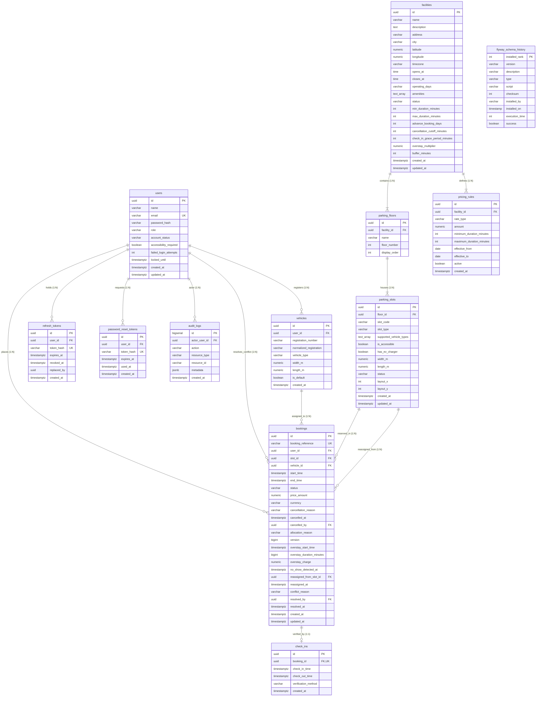

# SmartPark: Database Architecture & Schema Specification
## Enterprise Relational Catalog & PostgreSQL 16 Technical Specification

**Semester 3 Mini Project Documentation**  
**Database Engine:** PostgreSQL 16 (Alpine) via Docker Container `smartpark-postgres`  
**Migration Framework:** Flyway 10.x Version-Controlled Database Evolution  

---

## 1. Relational Summary & Architecture

The SmartPark data tier is built upon **PostgreSQL 16**, leveraging kernel-level spatio-temporal indexing and cryptographic extensions. The database operates under strict relational integrity with zero unpersisted or decorative mock data.

- **Database Engine:** PostgreSQL 16 (Alpine)
- **Database Catalog Name:** `smartpark`
- **Application User:** `smartpark`
- **Total Tables:** **12** (11 Application Domain Tables + 1 Flyway Schema Migration History Table)
- **Active Schema Migrations:** `V1__init.sql` through `V4__no_show_and_overstay_management.sql`
- **Core PostgreSQL Extensions:**
  - `uuid-ossp` / `gen_random_uuid()` — Cryptographic 128-bit UUIDv4 primary keys.
  - `btree_gist` — Allows composite scalar (`UUID`, `VARCHAR`) and temporal range (`tstzrange`) types to be evaluated inside Generalized Search Tree (GiST) exclusion constraints.

---

## 2. Entity-Relationship (ER) Diagram



---

## 3. Comprehensive Table Catalog (All 12 Tables)

### Table 1: `users`
Stores system accounts, authentication credentials, security lockout states, roles, and accessibility preferences.

| Column Name | SQL Data Type | Nullable | Default | Constraints & Relationships | Purpose / Description |
| :--- | :--- | :--- | :--- | :--- | :--- |
| `id` | `UUID` | **NO** | `gen_random_uuid()` | `PRIMARY KEY` | Cryptographic unique user identifier |
| `name` | `VARCHAR(120)` | **NO** | *None* | *None* | Full display name of the customer or admin |
| `email` | `VARCHAR(255)` | **NO** | *None* | `UNIQUE (uk_users_email)`, `CHECK (email = lower(email))` | Unique email login identity (strictly lowercase) |
| `password_hash` | `VARCHAR(120)` | **NO** | *None* | *None* | Salted BCrypt password hash (cost factor 12) |
| `role` | `VARCHAR(20)` | **NO** | `'USER'` | `CHECK (role IN ('USER', 'ADMIN'))` | Role-based authorization permission level |
| `account_status` | `VARCHAR(20)` | **NO** | `'ACTIVE'` | `CHECK (account_status IN ('ACTIVE', 'DISABLED'))` | Operational state of the user account |
| `accessibility_required` | `BOOLEAN` | **NO** | `false` | *None* | Flag indicating requirement for accessible bays |
| `failed_login_attempts` | `INTEGER` | **NO** | `0` | *None* | Counter for consecutive incorrect password attempts |
| `locked_until` | `TIMESTAMPTZ` | YES | `NULL` | *None* | Lockout release timestamp for brute-force defense |
| `created_at` | `TIMESTAMPTZ` | **NO** | `now()` | *None* | Record registration audit timestamp |
| `updated_at` | `TIMESTAMPTZ` | **NO** | `now()` | *None* | Timestamp of last profile or password modification |

- **Primary Key:** `users_pkey` (`id`)
- **Unique Constraints:** `uk_users_email` (`email`)
- **Check Constraints:** `chk_users_email_lower` (`email = lower(email)`), `users_role_check` (`role IN ('USER', 'ADMIN')`), `users_account_status_check` (`account_status IN ('ACTIVE', 'DISABLED')`)
- **Indexes:** `users_pkey` (BTREE), `uk_users_email` (BTREE)

---

### Table 2: `vehicles`
Stores registered vehicles linked to users, capturing dimensions and powertrain categories.

| Column Name | SQL Data Type | Nullable | Default | Constraints & Relationships | Purpose / Description |
| :--- | :--- | :--- | :--- | :--- | :--- |
| `id` | `UUID` | **NO** | `gen_random_uuid()` | `PRIMARY KEY` | Unique vehicle identifier |
| `user_id` | `UUID` | **NO** | *None* | `FOREIGN KEY -> users(id) ON DELETE CASCADE` | Owner user identifier |
| `registration_number` | `VARCHAR(20)` | **NO** | *None* | *None* | Display license plate (e.g. `'MH 12 AB 3456'`) |
| `normalized_registration` | `VARCHAR(20)` | **NO** | *None* | *None* | Clean uppercase alphanumeric string (e.g. `'MH12AB3456'`) |
| `vehicle_type` | `VARCHAR(20)` | **NO** | *None* | `CHECK (vehicle_type IN ('CAR', 'SUV', 'MOTORCYCLE', 'EV'))` | Vehicle category for bay compatibility checking |
| `width_m` | `NUMERIC(4,2)` | YES | `NULL` | *None* | Vehicle width in meters (e.g. `1.85`) |
| `length_m` | `NUMERIC(4,2)` | YES | `NULL` | *None* | Vehicle length in meters (e.g. `4.60`) |
| `is_default` | `BOOLEAN` | **NO** | `false` | *None* | Primary vehicle flag for rapid reservation |
| `created_at` | `TIMESTAMPTZ` | **NO** | `now()` | *None* | Timestamp when vehicle was registered |

- **Primary Key:** `vehicles_pkey` (`id`)
- **Unique Constraints:** `uk_vehicles_user_registration` (`user_id, normalized_registration`)
- **Foreign Keys:** `fk_vehicles_user` (`user_id -> users(id) ON DELETE CASCADE`)
- **Indexes:** `vehicles_pkey` (BTREE), `uk_vehicles_user_registration` (BTREE), `idx_vehicles_user` (BTREE on `user_id`)

---

### Table 3: `facilities`
Stores physical parking facilities, garages, and lots along with operating rules, grace periods, and tariffs.

| Column Name | SQL Data Type | Nullable | Default | Constraints & Relationships | Purpose / Description |
| :--- | :--- | :--- | :--- | :--- | :--- |
| `id` | `UUID` | **NO** | `gen_random_uuid()` | `PRIMARY KEY` | Unique parking facility identifier |
| `name` | `VARCHAR(160)` | **NO** | *None* | *None* | Facility commercial name |
| `description` | `TEXT` | **NO** | `''` | *None* | Detailed landmark description and entry instructions |
| `address` | `VARCHAR(255)` | **NO** | *None* | *None* | Physical street address |
| `city` | `VARCHAR(120)` | **NO** | *None* | *None* | Municipality / City (e.g. `'Pune'`) |
| `latitude` | `NUMERIC(9,6)` | YES | `NULL` | *None* | WGS84 GPS latitude for mapping |
| `longitude` | `NUMERIC(9,6)` | YES | `NULL` | *None* | WGS84 GPS longitude for mapping |
| `timezone` | `VARCHAR(64)` | **NO** | `'Asia/Kolkata'` | *None* | Timezone name for operational hours conversion |
| `opens_at` | `TIME` | **NO** | *None* | *None* | Daily opening time (e.g. `'06:00:00'`) |
| `closes_at` | `TIME` | **NO** | *None* | `CHECK (closes_at > opens_at)` | Daily closing time (e.g. `'23:00:00'`) |
| `operating_days` | `VARCHAR(40)` | **NO** | `'MON,TUE,WED,THU,FRI,SAT,SUN'` | *None* | Comma-delimited list of operational weekdays |
| `amenities` | `TEXT[]` | **NO** | `'{}'` | *None* | Array of facility features (e.g. `'{CCTV,EV Charging}'`) |
| `status` | `VARCHAR(20)` | **NO** | `'ACTIVE'` | `CHECK (status IN ('ACTIVE', 'INACTIVE', 'MAINTENANCE'))` | Current operational state |
| `min_duration_minutes` | `INTEGER` | **NO** | `60` | `CHECK (min_duration_minutes >= 15)` | Minimum allowable booking window (minutes) |
| `max_duration_minutes` | `INTEGER` | **NO** | `720` | `CHECK (max_duration_minutes <= 10080)` | Maximum single booking window (minutes) |
| `advance_booking_days` | `INTEGER` | **NO** | `30` | `CHECK (advance_booking_days BETWEEN 1 AND 365)` | Days in advance drivers may book |
| `cancellation_cutoff_minutes`| `INTEGER` | **NO** | `60` | `CHECK (cancellation_cutoff_minutes >= 0)` | Advance minutes required to cancel booking |
| `check_in_grace_period_minutes`| `INTEGER` | **NO** | `15` | `CHECK (check_in_grace_period_minutes >= 0)` | Minutes before driver is marked as `NO_SHOW` (Added V4) |
| `overstay_multiplier` | `NUMERIC(4,2)` | **NO** | `1.50` | `CHECK (overstay_multiplier >= 1.00)` | Penalty tariff multiplier for overstay durations (Added V4) |
| `buffer_minutes` | `INTEGER` | **NO** | `15` | `CHECK (buffer_minutes BETWEEN 0 AND 120)` | Clean/turnaround buffer between reservations |
| `created_at` | `TIMESTAMPTZ` | **NO** | `now()` | *None* | Creation audit timestamp |
| `updated_at` | `TIMESTAMPTZ` | **NO** | `now()` | *None* | Last update audit timestamp |

- **Primary Key:** `facilities_pkey` (`id`)
- **Check Constraints:** `chk_facilities_hours` (`closes_at > opens_at`), `chk_facilities_durations` (`max_duration_minutes > min_duration_minutes`), `facilities_status_check` (`status IN ('ACTIVE', 'INACTIVE', 'MAINTENANCE')`)
- **Indexes:** `facilities_pkey` (BTREE), `idx_facilities_status` (BTREE on `status`)

---

### Table 4: `parking_floors`
Stores multi-level floors within facilities.

| Column Name | SQL Data Type | Nullable | Default | Constraints & Relationships | Purpose / Description |
| :--- | :--- | :--- | :--- | :--- | :--- |
| `id` | `UUID` | **NO** | `gen_random_uuid()` | `PRIMARY KEY` | Unique floor identifier |
| `facility_id` | `UUID` | **NO** | *None* | `FOREIGN KEY -> facilities(id) ON DELETE CASCADE` | Enclosing facility identifier |
| `name` | `VARCHAR(80)` | **NO** | *None* | *None* | Floor display label (e.g. `'Basement 1'`, `'Level 2'`) |
| `floor_number` | `INTEGER` | **NO** | *None* | *None* | Physical elevation index (`-1`, `0`, `1`, `2`) |
| `display_order` | `INTEGER` | **NO** | `0` | *None* | Visual UI ordering weight |

- **Primary Key:** `parking_floors_pkey` (`id`)
- **Unique Constraints:** `uk_floors_facility_name` (`facility_id, name`), `uk_floors_facility_number` (`facility_id, floor_number`)
- **Foreign Keys:** `fk_floors_facility` (`facility_id -> facilities(id) ON DELETE CASCADE`)
- **Indexes:** `parking_floors_pkey` (BTREE), `uk_floors_facility_name` (BTREE), `uk_floors_facility_number` (BTREE), `idx_floors_facility` (BTREE on `facility_id`)

---

### Table 5: `parking_slots`
Stores individual parking bays on floors with hardware features and physical dimensions.

| Column Name | SQL Data Type | Nullable | Default | Constraints & Relationships | Purpose / Description |
| :--- | :--- | :--- | :--- | :--- | :--- |
| `id` | `UUID` | **NO** | `gen_random_uuid()` | `PRIMARY KEY` | Unique parking bay identifier |
| `floor_id` | `UUID` | **NO** | *None* | `FOREIGN KEY -> parking_floors(id) ON DELETE CASCADE` | Parent floor identifier |
| `slot_code` | `VARCHAR(20)` | **NO** | *None* | *None* | Bay visual signage (e.g. `'G-01'`, `'B1-14'`) |
| `slot_type` | `VARCHAR(20)` | **NO** | *None* | `CHECK (slot_type IN ('STANDARD', 'COMPACT', 'LARGE', 'EV', 'ACCESSIBLE', 'MOTORCYCLE'))` | Bay classification type |
| `supported_vehicle_types` | `TEXT[]` | **NO** | `'{CAR,SUV}'` | *None* | Array of permissible vehicle classes |
| `is_accessible` | `BOOLEAN` | **NO** | `false` | *None* | ADA / wheelchair accessibility compliance |
| `has_ev_charger` | `BOOLEAN` | **NO** | `false` | *None* | Fast charging station installed at bay |
| `width_m` | `NUMERIC(4,2)` | **NO** | `2.50` | *None* | Physical bay width in meters |
| `length_m` | `NUMERIC(4,2)` | **NO** | `5.00` | *None* | Physical bay length in meters |
| `status` | `VARCHAR(20)` | **NO** | `'AVAILABLE'` | `CHECK (status IN ('AVAILABLE', 'OUT_OF_SERVICE'))` | Operational maintenance state |
| `layout_x` | `INTEGER` | YES | `NULL` | *None* | 2D canvas visual grid X-coordinate |
| `layout_y` | `INTEGER` | YES | `NULL` | *None* | 2D canvas visual grid Y-coordinate |
| `created_at` | `TIMESTAMPTZ` | **NO** | `now()` | *None* | Creation timestamp |
| `updated_at` | `TIMESTAMPTZ` | **NO** | `now()` | *None* | Update timestamp |

- **Primary Key:** `parking_slots_pkey` (`id`)
- **Unique Constraints:** `uk_slots_floor_code` (`floor_id, slot_code`)
- **Foreign Keys:** `fk_slots_floor` (`floor_id -> parking_floors(id) ON DELETE CASCADE`)
- **Indexes:** `parking_slots_pkey` (BTREE), `uk_slots_floor_code` (BTREE), `idx_slots_floor` (BTREE on `floor_id`), `idx_slots_status` (BTREE on `status`)

---

### Table 6: `pricing_rules`
Stores pricing tariff schedules configured per facility.

| Column Name | SQL Data Type | Nullable | Default | Constraints & Relationships | Purpose / Description |
| :--- | :--- | :--- | :--- | :--- | :--- |
| `id` | `UUID` | **NO** | `gen_random_uuid()` | `PRIMARY KEY` | Unique pricing rule identifier |
| `facility_id` | `UUID` | **NO** | *None* | `FOREIGN KEY -> facilities(id) ON DELETE CASCADE` | Associated facility identifier |
| `rate_type` | `VARCHAR(20)` | **NO** | *None* | `CHECK (rate_type IN ('HOURLY', 'DAILY', 'FLAT'))` | Billing unit calculation model |
| `amount` | `NUMERIC(10,2)` | **NO** | *None* | `CHECK (amount >= 0)` | Price per unit in INR (e.g. `80.00`) |
| `minimum_duration_minutes` | `INTEGER` | **NO** | `60` | *None* | Lower bound duration for this rule |
| `maximum_duration_minutes` | `INTEGER` | **NO** | `720` | *None* | Upper bound duration for this rule |
| `effective_from` | `DATE` | **NO** | `CURRENT_DATE` | *None* | Starting date of rule validity |
| `effective_to` | `DATE` | YES | `NULL` | `CHECK (effective_to IS NULL OR effective_to >= effective_from)` | Expiry date of rule validity |
| `active` | `BOOLEAN` | **NO** | `true` | *None* | Active toggle for rule evaluation |
| `created_at` | `TIMESTAMPTZ` | **NO** | `now()` | *None* | Creation timestamp |

- **Primary Key:** `pricing_rules_pkey` (`id`)
- **Foreign Keys:** `fk_pricing_facility` (`facility_id -> facilities(id) ON DELETE CASCADE`)
- **Indexes:** `pricing_rules_pkey` (BTREE), `idx_pricing_facility` (BTREE on `(facility_id, active)`)

---

### Table 7: `bookings`
Core reservation ledger tracking drivers, bays, time windows, prices, optimistic locking, and lifecycle states.

| Column Name | SQL Data Type | Nullable | Default | Constraints & Relationships | Purpose / Description |
| :--- | :--- | :--- | :--- | :--- | :--- |
| `id` | `UUID` | **NO** | `gen_random_uuid()` | `PRIMARY KEY` | Unique booking identifier |
| `booking_reference` | `VARCHAR(24)` | **NO** | *None* | `UNIQUE (uk_bookings_reference)` | Human-readable reservation code (e.g. `'SP-7K2M9X'`) |
| `user_id` | `UUID` | **NO** | *None* | `FOREIGN KEY -> users(id) ON DELETE RESTRICT` | Booking customer identifier |
| `slot_id` | `UUID` | **NO** | *None* | `FOREIGN KEY -> parking_slots(id) ON DELETE RESTRICT` | Reserved parking bay identifier |
| `vehicle_id` | `UUID` | **NO** | *None* | `FOREIGN KEY -> vehicles(id) ON DELETE RESTRICT` | Vehicle assigned to reservation |
| `start_time` | `TIMESTAMPTZ` | **NO** | *None* | *None* | Scheduled reservation arrival timestamp |
| `end_time` | `TIMESTAMPTZ` | **NO** | *None* | `CHECK (end_time > start_time)` | Scheduled reservation departure timestamp |
| `status` | `VARCHAR(30)` | **NO** | `'CONFIRMED'` | `CHECK (chk_bookings_status)` | Lifecycle status (9 supported states) |
| `price_amount` | `NUMERIC(10,2)` | **NO** | *None* | `CHECK (price_amount >= 0)` | Agreed base fare in INR locked at booking creation |
| `currency` | `VARCHAR(3)` | **NO** | `'INR'` | *None* | ISO currency code |
| `cancellation_reason` | `VARCHAR(500)` | YES | `NULL` | *None* | Driver reason or system cancellation note |
| `cancelled_at` | `TIMESTAMPTZ` | YES | `NULL` | *None* | Timestamp of cancellation |
| `cancelled_by` | `UUID` | YES | `NULL` | `FOREIGN KEY -> users(id) ON DELETE SET NULL` | User/Admin who cancelled the booking |
| `allocation_reason` | `VARCHAR(500)` | YES | `NULL` | *None* | Explanation of slot assignment or reassignment |
| `version` | `BIGINT` | **NO** | `0` | *None* | JPA Optimistic Locking version counter |
| `overstay_start_time` | `TIMESTAMPTZ` | YES | `NULL` | *None* | Timestamp when scheduled end time was breached (Added V4) |
| `overstay_duration_minutes`| `BIGINT` | **NO** | `0` | *None* | Total overstay duration in minutes (Added V4) |
| `overstay_charge` | `NUMERIC(10,2)` | **NO** | `0.00` | `CHECK (overstay_charge >= 0)` | Accumulated penalty fee in INR (Added V4) |
| `no_show_detected_at` | `TIMESTAMPTZ` | YES | `NULL` | *None* | Timestamp when no-show was registered (Added V4) |
| `reassigned_from_slot_id` | `UUID` | YES | `NULL` | `FOREIGN KEY -> parking_slots(id) ON DELETE SET NULL`| Original slot ID prior to overstay reassignment (Added V4) |
| `reassigned_at` | `TIMESTAMPTZ` | YES | `NULL` | *None* | Timestamp when bay was reallocated (Added V4) |
| `conflict_reason` | `VARCHAR(500)` | YES | `NULL` | *None* | Details regarding unresolved physical bay blockage (Added V4) |
| `resolved_by` | `UUID` | YES | `NULL` | `FOREIGN KEY -> users(id) ON DELETE SET NULL` | Administrator who manually resolved conflict (Added V4) |
| `resolved_at` | `TIMESTAMPTZ` | YES | `NULL` | *None* | Timestamp when conflict was resolved (Added V4) |
| `created_at` | `TIMESTAMPTZ` | **NO** | `now()` | *None* | Booking creation timestamp |
| `updated_at` | `TIMESTAMPTZ` | **NO** | `now()` | *None* | Last update timestamp |

- **Primary Key:** `bookings_pkey` (`id`)
- **Unique Constraints:** `uk_bookings_reference` (`booking_reference`)
- **Check Constraints:** 
  - `chk_bookings_time` (`end_time > start_time`)
  - `bookings_price_amount_check` (`price_amount >= 0`)
  - `bookings_overstay_charge_check` (`overstay_charge >= 0`)
  - `chk_bookings_status`:
    ```sql
    CHECK (status IN ('PENDING', 'CONFIRMED', 'ACTIVE', 'OVERSTAY', 'NO_SHOW', 'COMPLETED', 'CANCELLED', 'EXPIRED', 'CONFLICT_REQUIRES_ADMIN'))
    ```
- **Authoritative GiST Exclusion Constraint:**
  ```sql
  CONSTRAINT excl_bookings_slot_time
  EXCLUDE USING gist (
      slot_id WITH =,
      tstzrange(start_time, end_time, '[)') WITH &&
  ) WHERE (status IN ('PENDING', 'CONFIRMED', 'ACTIVE', 'OVERSTAY', 'CONFLICT_REQUIRES_ADMIN'))
  ```
- **Indexes:**
  - `bookings_pkey` (BTREE on `id`)
  - `uk_bookings_reference` (BTREE on `booking_reference`)
  - `idx_bookings_user` (BTREE on `user_id`)
  - `idx_bookings_status` (BTREE on `status`)
  - `idx_bookings_slot_time` (GIST on `slot_id, tstzrange(start_time, end_time, '[)')`)
  - `idx_bookings_overstay` (BTREE on `status` WHERE `status IN ('ACTIVE', 'OVERSTAY')`)
  - `idx_bookings_conflict` (BTREE on `status` WHERE `status = 'CONFLICT_REQUIRES_ADMIN'`)
  - `idx_bookings_noshow` (BTREE on `status` WHERE `status = 'NO_SHOW'`)
  - `idx_bookings_slot_reassigned` (BTREE on `reassigned_from_slot_id`)

---

### Table 8: `check_ins`
Stores physical gate barrier entry and departure audit records.

| Column Name | SQL Data Type | Nullable | Default | Constraints & Relationships | Purpose / Description |
| :--- | :--- | :--- | :--- | :--- | :--- |
| `id` | `UUID` | **NO** | `gen_random_uuid()` | `PRIMARY KEY` | Unique check-in record identifier |
| `booking_id` | `UUID` | **NO** | *None* | `FOREIGN KEY -> bookings(id) ON DELETE RESTRICT`, `UNIQUE` | One-to-one link to reservation record |
| `check_in_time` | `TIMESTAMPTZ` | **NO** | `now()` | *None* | Timestamp of physical arrival at entry barrier |
| `check_out_time` | `TIMESTAMPTZ` | YES | `NULL` | *None* | Timestamp of physical departure at exit barrier |
| `verification_method` | `VARCHAR(30)` | **NO** | *None* | `CHECK (verification_method IN ('QR', 'MANUAL', 'ADMIN'))`| Gate verification modality |
| `created_at` | `TIMESTAMPTZ` | **NO** | `now()` | *None* | Creation timestamp |

- **Primary Key:** `check_ins_pkey` (`id`)
- **Unique Constraints:** `uk_check_ins_booking` (`booking_id`)
- **Indexes:** `check_ins_pkey` (BTREE), `uk_check_ins_booking` (BTREE), `idx_check_ins_booking` (BTREE on `booking_id`)

---

### Table 9: `refresh_tokens`
Stores hashed single-use cryptographic refresh tokens for session rotation.

| Column Name | SQL Data Type | Nullable | Default | Constraints & Relationships | Purpose / Description |
| :--- | :--- | :--- | :--- | :--- | :--- |
| `id` | `UUID` | **NO** | `gen_random_uuid()` | `PRIMARY KEY` | Unique token identifier |
| `user_id` | `UUID` | **NO** | *None* | `FOREIGN KEY -> users(id) ON DELETE CASCADE` | Associated user identity |
| `token_hash` | `VARCHAR(128)` | **NO** | *None* | `UNIQUE (uk_refresh_tokens_hash)` | SHA-256 hash of random 64-byte token |
| `expires_at` | `TIMESTAMPTZ` | **NO** | *None* | *None* | Token expiration timestamp (7 days) |
| `revoked_at` | `TIMESTAMPTZ` | YES | `NULL` | *None* | Invalidation timestamp upon logout or rotation |
| `replaced_by` | `UUID` | YES | `NULL` | *None* | Successor token ID in the rotation chain |
| `created_at` | `TIMESTAMPTZ` | **NO** | `now()` | *None* | Token issuance timestamp |

- **Primary Key:** `refresh_tokens_pkey` (`id`)
- **Unique Constraints:** `uk_refresh_tokens_hash` (`token_hash`)
- **Foreign Keys:** `fk_refresh_tokens_user` (`user_id -> users(id) ON DELETE CASCADE`)
- **Indexes:** `refresh_tokens_pkey` (BTREE), `uk_refresh_tokens_hash` (BTREE), `idx_refresh_tokens_user` (BTREE on `user_id` WHERE `revoked_at IS NULL`)

---

### Table 10: `password_reset_tokens`
Stores temporary hashed recovery tokens for forgotten password resets.

| Column Name | SQL Data Type | Nullable | Default | Constraints & Relationships | Purpose / Description |
| :--- | :--- | :--- | :--- | :--- | :--- |
| `id` | `UUID` | **NO** | `gen_random_uuid()` | `PRIMARY KEY` | Unique reset token identifier |
| `user_id` | `UUID` | **NO** | *None* | `FOREIGN KEY -> users(id) ON DELETE CASCADE` | Targeted user account |
| `token_hash` | `VARCHAR(128)` | **NO** | *None* | `UNIQUE (uk_password_reset_hash)` | SHA-256 hash of random reset token string |
| `expires_at` | `TIMESTAMPTZ` | **NO** | *None* | *None* | Token expiration timestamp (30 minutes) |
| `used_at` | `TIMESTAMPTZ` | YES | `NULL` | *None* | Consumption timestamp upon password update |
| `created_at` | `TIMESTAMPTZ` | **NO** | `now()` | *None* | Token generation timestamp |

- **Primary Key:** `password_reset_tokens_pkey` (`id`)
- **Unique Constraints:** `uk_password_reset_hash` (`token_hash`)
- **Foreign Keys:** `fk_password_reset_user` (`user_id -> users(id) ON DELETE CASCADE`)
- **Indexes:** `password_reset_tokens_pkey` (BTREE), `uk_password_reset_hash` (BTREE)

---

### Table 11: `audit_logs`
Immutable, append-only security and operational audit trail.

| Column Name | SQL Data Type | Nullable | Default | Constraints & Relationships | Purpose / Description |
| :--- | :--- | :--- | :--- | :--- | :--- |
| `id` | `BIGSERIAL` | **NO** | *Next auto sequence*| `PRIMARY KEY` | Monotonically increasing 64-bit log sequence ID |
| `actor_user_id` | `UUID` | YES | `NULL` | `FOREIGN KEY -> users(id) ON DELETE SET NULL`| User who executed the action (`NULL` for system worker) |
| `action` | `VARCHAR(80)` | **NO** | *None* | *None* | Audited action code (e.g. `'BOOKING_CREATED'`, `'LOGIN_FAILED'`) |
| `resource_type` | `VARCHAR(60)` | **NO** | *None* | *None* | Target domain entity (e.g. `'BOOKING'`, `'USER'`, `'SLOT'`) |
| `resource_id` | `VARCHAR(64)` | YES | `NULL` | *None* | Stringified primary key of the target resource |
| `metadata` | `JSONB` | **NO** | `'{}'::jsonb` | *None* | Arbitrary structured JSON payload with contextual parameters |
| `created_at` | `TIMESTAMPTZ` | **NO** | `now()` | *None* | Immutable timestamp when action occurred |

- **Primary Key:** `audit_logs_pkey` (`id`)
- **Foreign Keys:** `fk_audit_actor` (`actor_user_id -> users(id) ON DELETE SET NULL`)
- **Indexes:** `audit_logs_pkey` (BTREE), `idx_audit_actor` (BTREE on `actor_user_id`), `idx_audit_resource` (BTREE on `(resource_type, resource_id)`), `idx_audit_created` (BTREE on `created_at DESC`)

---

### Table 12: `flyway_schema_history`
Flyway internal migration tracking table.

| Column Name | SQL Data Type | Nullable | Default | Purpose / Description |
| :--- | :--- | :--- | :--- | :--- |
| `installed_rank` | `INTEGER` | **NO** | *None* | Migration execution order (Primary Key) |
| `version` | `VARCHAR(50)` | YES | `NULL` | Migration version string (`'1'`, `'2'`, `'3'`, `'4'`) |
| `description` | `VARCHAR(200)` | **NO** | *None* | Human-readable migration description |
| `type` | `VARCHAR(20)` | **NO** | *None* | Migration script type (`'SQL'`) |
| `script` | `VARCHAR(1000)`| **NO** | *None* | Migration file name |
| `checksum` | `INTEGER` | YES | `NULL` | Checksum for cryptographic drift verification |
| `installed_by` | `VARCHAR(100)` | **NO** | *None* | Database user who executed the migration (`smartpark`) |
| `installed_on` | `TIMESTAMP` | **NO** | `now()` | Timestamp of migration execution |
| `execution_time` | `INTEGER` | **NO** | *None* | Execution duration in milliseconds |
| `success` | `BOOLEAN` | **NO** | *None* | Flag indicating whether migration succeeded |

---

## 4. Referential Integrity & Foreign Key Actions

```
+---------------------------------------------------------------------------------------------------------+
|                                    FOREIGN KEY REFERENTIAL ACTIONS                                      |
+--------------------------+-----------------------+-----------------------------+------------------------+
| Child Table              | Foreign Key Column    | Parent Table (Column)       | Referential Action     |
+--------------------------+-----------------------+-----------------------------+------------------------+
| vehicles                 | user_id               | users (id)                  | ON DELETE CASCADE      |
| parking_floors           | facility_id           | facilities (id)             | ON DELETE CASCADE      |
| parking_slots            | floor_id              | parking_floors (id)         | ON DELETE CASCADE      |
| pricing_rules            | facility_id           | facilities (id)             | ON DELETE CASCADE      |
| bookings                 | user_id               | users (id)                  | ON DELETE RESTRICT     |
| bookings                 | slot_id               | parking_slots (id)          | ON DELETE RESTRICT     |
| bookings                 | vehicle_id            | vehicles (id)               | ON DELETE RESTRICT     |
| bookings                 | cancelled_by          | users (id)                  | ON DELETE SET NULL     |
| bookings                 | reassigned_from_slot_id| parking_slots (id)         | ON DELETE SET NULL     |
| bookings                 | resolved_by           | users (id)                  | ON DELETE SET NULL     |
| check_ins                | booking_id            | bookings (id)               | ON DELETE RESTRICT     |
| refresh_tokens           | user_id               | users (id)                  | ON DELETE CASCADE      |
| password_reset_tokens    | user_id               | users (id)                  | ON DELETE CASCADE      |
| audit_logs               | actor_user_id         | users (id)                  | ON DELETE SET NULL     |
+--------------------------+-----------------------+-----------------------------+------------------------+
```

---

## 5. Mathematical Double-Booking Prevention: GiST Constraint Defense

The definitive concurrency defense in SmartPark is the PostgreSQL Generalized Search Tree (`gist`) exclusion constraint:

```sql
ALTER TABLE bookings
ADD CONSTRAINT excl_bookings_slot_time
EXCLUDE USING gist (
    slot_id WITH =,
    tstzrange(start_time, end_time, '[)') WITH &&
)
WHERE (status IN ('PENDING', 'CONFIRMED', 'ACTIVE', 'OVERSTAY', 'CONFLICT_REQUIRES_ADMIN'));
```

### Why Standard Application-Level Checks Fail
An application-level check such as:
```sql
SELECT COUNT(*) FROM bookings 
WHERE slot_id = :slotId 
  AND status IN ('CONFIRMED', 'ACTIVE')
  AND start_time < :reqEnd AND end_time > :reqStart;
```
is inherently susceptible to **Time-of-Check to Time-of-Use (TOCTOU)** race conditions. If two concurrent threads execute this check simultaneously, both receive `COUNT = 0`. Both threads subsequently issue an `INSERT INTO bookings ...`, creating an overlapping reservation.

### How PostgreSQL Kernel-Level GiST Prevents Overlaps
1. **Scalar Equality:** The `slot_id WITH =` condition utilizes B-Tree semantics inside the GiST index (via `btree_gist`).
2. **Range Overlap:** The `tstzrange(start_time, end_time, '[)') WITH &&` condition creates a half-open temporal interval $[T_{\text{start}}, T_{\text{end}})$.
3. The `&&` operator asserts mathematical intersection:
   $$[A_{\text{start}}, A_{\text{end}}) \cap [B_{\text{start}}, B_{\text{end}}) \neq \emptyset \iff (A_{\text{start}} < B_{\text{end}}) \land (B_{\text{start}} < A_{\text{end}})$$
4. When a transaction attempts to insert or update an overlapping interval on the same bay, PostgreSQL's storage engine immediately aborts the conflicting transaction with an exclusion violation:
   ```
   ERROR: conflicting key value violates exclusion constraint "excl_bookings_slot_time"
   SQLSTATE: 23P01 (exclusion_violation)
   ```
5. Spring Boot catches this database exception and translates it into an actionable HTTP `409 Conflict` response.
