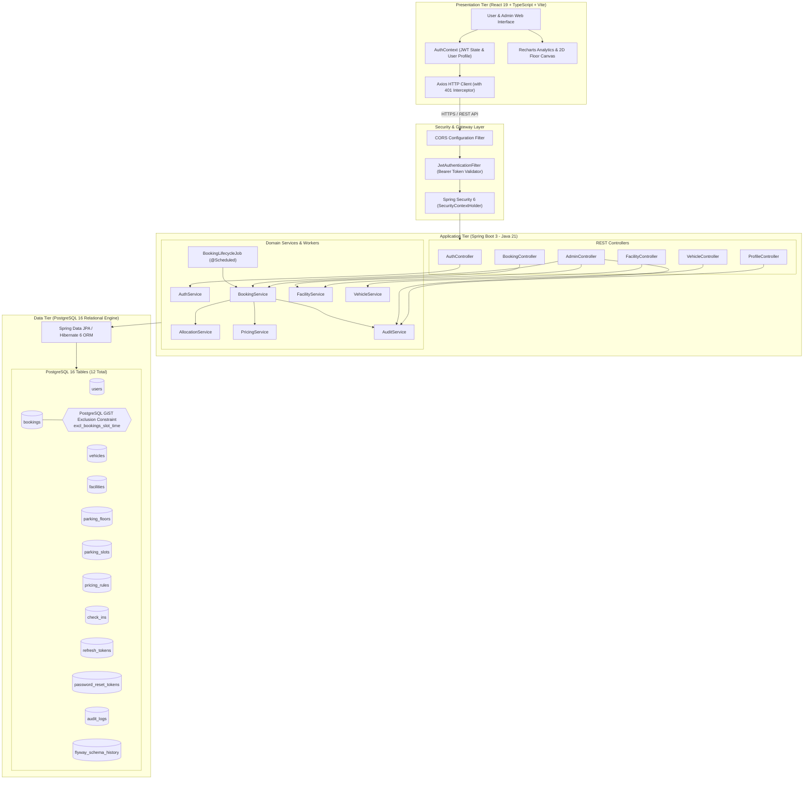
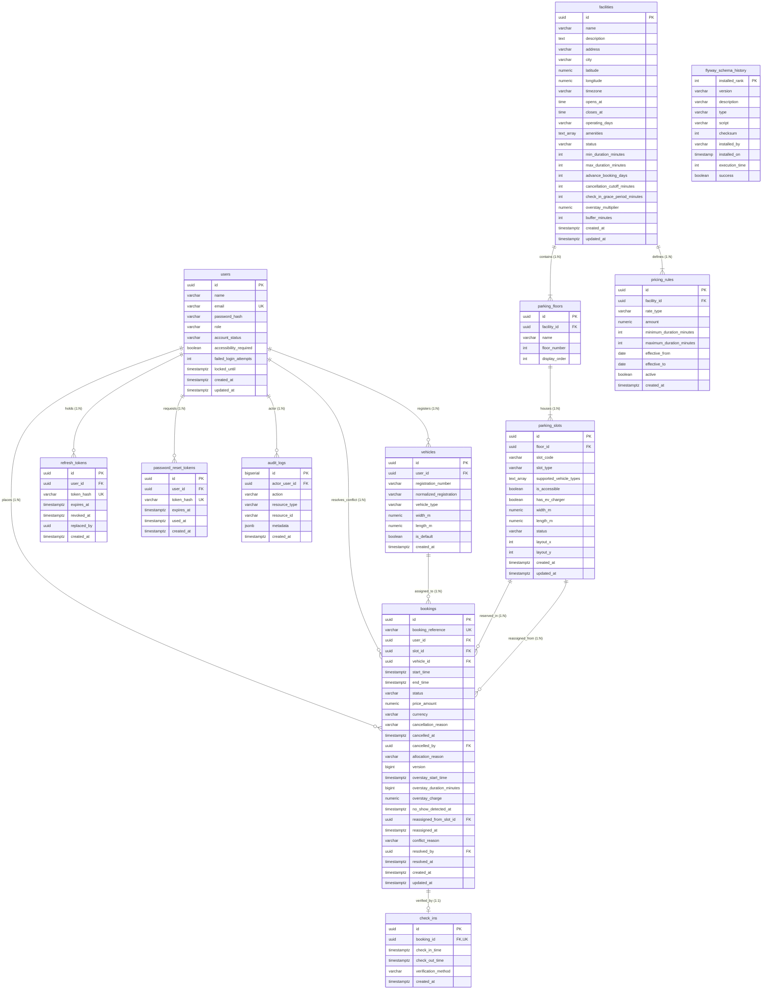
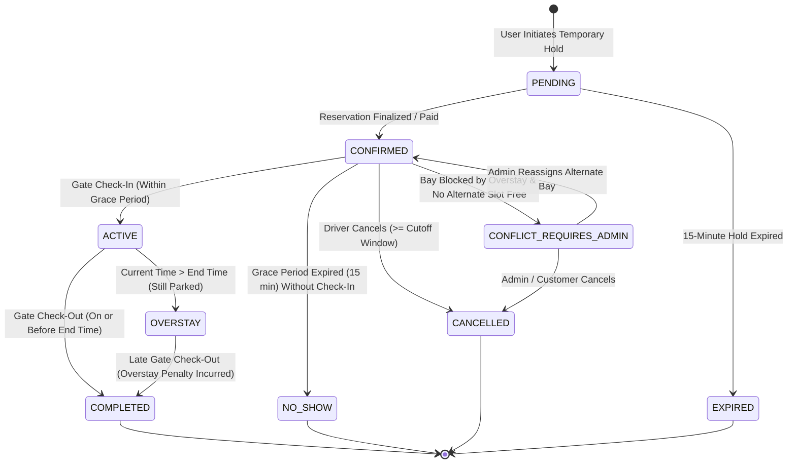

# SmartPark: Smart Parking Management System
## Comprehensive Mini Project Review & Engineering Defense Report

**Academic Review Documentation — Semester 3 Mini Project**  
**Repository:** `SmartPark — Full Stack Web Application`  
**Target Review Jury:** Faculty Evaluators, Department of Computer Science & Engineering  

---

## Table of Contents
1. [Executive Summary](#1-executive-summary)
2. [Project Overview](#2-project-overview)
   - Problem Statement
   - Proposed Solution
   - Core Objectives & Project Scope
   - Target User Personas
   - Technology Stack Breakdown
   - Distinctive Technical Highlights
3. [System Architecture & Data Flow](#3-system-architecture--data-flow)
   - Architectural Blueprint
   - System Architecture Diagram (Mermaid)
   - Layered Component Decomposition
   - Client-Server Communication & Data Flow
4. [Functional Modules Catalog](#4-functional-modules-catalog)
   - Module 1: Authentication & Identity Management
   - Module 2: User Profile & Personal Activity Audit
   - Module 3: Parking Facility & Infrastructure Catalog
   - Module 4: Parking Bay Inventory & Interactive 2D Visualizer
   - Module 5: Vehicle Fleet & Dimensional Compatibility
   - Module 6: Booking, Dynamic Pricing & Quotation Engine
   - Module 7: Gate Check-In, Check-Out & Cryptographic QR Verification
   - Module 8: Automated Lifecycle Management (No-Show, Overstay & Conflict Engine)
   - Module 9: Administrative Oversight, Operations Dashboard & Audit System
5. [Database Architecture & Schema Specification](#5-database-architecture--schema-specification)
   - Relational Architecture & PostgreSQL Extensions
   - Entity-Relationship Diagram (Mermaid)
   - Exhaustive Table Catalog (All 12 Tables with Full Schemas)
   - Relational Integrity, Foreign Keys & Key Constraints
   - Database Indexing Strategy
   - Flyway Versioned Migration Ledger (V1 to V4)
6. [Critical Algorithms & Business Logic](#6-critical-algorithms--business-logic)
   - Mathematical Double-Booking Prevention (GiST Exclusion Constraint)
   - Temporal Slot Availability & Search Algorithm
   - Dynamic Multi-Tier Pricing & Overstay Penalty Engine
   - Vehicle Dimensions & Accessibility Matching Algorithm
   - Complete 9-State Booking Lifecycle Finite State Machine
   - Background Lifecycle Automation & Conflict Resolution Protocol
   - Cryptographic Check-In & Check-Out QR Flow
7. [Security Hardening & Access Control](#7-security-hardening--access-control)
   - Authentication Architecture (JWT & Refresh Token Rotation)
   - Role-Based Authorization (RBAC) & IDOR Defense
   - Brute-Force Rate Limiting & Account Lockout
   - Password Recovery Flow & Cryptographic Token Hashing
   - SQL Injection & Parameter Tampering Immunity
   - Structured Security Audit Logging Trail
8. [SQL Queries & Database Management Reference](#8-sql-queries--database-management-reference)
   - Demonstration SQL Catalog (`sql/` Directory)
   - Live Database Inspection Options (Adminer & psql)
9. [Automated Verification & Testing Report](#9-automated-verification--testing-report)
   - Test Execution Metrics (48 Tests, 100% Pass)
   - Test Suite Breakdown & Coverage
   - Multi-Threaded Concurrency Stress Test Validation
10. [Limitations & Academic Project Roadmap](#10-limitations--academic-project-roadmap)
11. [Review Jury Quick Reference Cheat Sheet](#11-review-jury-quick-reference-cheat-sheet)

---

## 1. Executive Summary

**SmartPark** is an enterprise-grade, full-stack, database-backed smart parking management platform engineered to resolve urban parking congestion, eradicate reservation race conditions, and automate multi-level parking facility administration.

Engineered with **Spring Boot 3 (Java 21 LTS)**, **PostgreSQL 16 (Alpine)**, and **React 19 (TypeScript 5 / Vite 7)**, SmartPark enforces **mathematical zero double-booking** at the database engine layer utilizing PostgreSQL Generalized Search Tree (**GiST**) spatio-temporal exclusion constraints with temporal ranges (`tstzrange`).

The system implements a deterministic **9-state booking lifecycle finite state machine** powered by an automated background worker (`BookingLifecycleJob.java`) that autonomously detects driver no-shows, applies overstay penalty multipliers (1.5x), reassigns downstream conflicting reservations, or escalates unresolved physical blockages to facility managers. Operating with 100% relational database backing and zero mock data, the system includes 48 automated integration and concurrency tests passing with a 100% success rate.

---

## 2. Project Overview

### Problem Statement
Urban drivers lose 15 to 25 minutes per trip seeking vacant parking spaces in commercial hubs, shopping complexes, and transit junctions. This causes severe traffic congestion, excessive fuel consumption, elevated carbon emissions, and driver frustration.

Existing commercial and academic parking platforms face critical flaws:
1. **Concurrency Failures:** High-demand booking peaks result in duplicate reservations of identical bays due to application-level `SELECT ... INSERT` race conditions (Time-of-Check to Time-of-Use / TOCTOU).
2. **Ghost Reservations & No-Shows:** Drivers book slots but fail to arrive, leaving bays vacant and unavailable for other drivers without automated cancellation or release mechanisms.
3. **Overstay Gridlock:** Vehicles remaining parked beyond their reserved window physically block incoming drivers with valid reservations, causing operational chaos at gates.
4. **Opaque & Inflexible Pricing:** Fixed rates disregard duration economics, while surge tariffs lack transparent mathematical explanations.
5. **Dimensional Incompatibility:** Compact bays are erroneously booked by large SUVs, or electric vehicle bays with fast chargers are blocked by internal combustion engine (ICE) cars.
6. **Weak Security & Session Vulnerabilities:** Many systems rely on plain passwords, stateless unrevocable tokens, or client-side authorization without database audit trails.

### Proposed Solution
SmartPark resolves these challenges through a unified, database-enforced architecture:
- **Mathematical Double-Booking Immunity:** Relies on PostgreSQL kernel-level GiST exclusion constraints combined with JPA `@Version` optimistic locking to reject overlapping bookings at the storage level.
- **Automated Lifecycle Sweeper:** An asynchronous scheduled background service checks reservations every 30 seconds, automatically flagging no-shows after facility grace periods (15 minutes), flagging overstays with penalty tariffs, and triggering automatic slot reassignments.
- **Interactive 2D Floor Visualizer:** Real-time visual floor plans rendering slot categories (`STANDARD`, `COMPACT`, `LARGE`, `EV`, `ACCESSIBLE`, `MOTORCYCLE`), physical dimensions, charger availability, and live occupancy states.
- **Transparent Multi-Tier Pricing Engine:** Deterministic hourly, daily, and flat tariff calculation with automated overstay penalty multipliers computed strictly on the backend.
- **Cryptographic Gate Verification:** Signed HMAC-SHA256 QR passes for mobile entry and departure verification.
- **Comprehensive Administrative Command Center:** Live facility configuration, multi-floor bay editing, overstay dashboard, manual conflict resolution, user role management, and immutable audit logs.

### Core Objectives & Project Scope
- **Deterministic Concurrency:** Zero simultaneous overlapping bookings under any concurrency volume.
- **Complete Relational Rigor:** 100% database persistence across 12 version-controlled PostgreSQL tables via Flyway migrations.
- **Hardened Security:** BCrypt hashing (cost factor 12), ephemeral 15-minute access JWTs, single-use rotating refresh tokens stored hashed in the database and delivered in `HttpOnly` / `SameSite=Strict` cookies, and brute-force account lockout.
- **High Test Confidence:** 48 automated test cases spanning unit rules, security filters, allocation algorithms, and multi-threaded race condition tests.

### Target User Personas
1. **Registered Vehicle Drivers (End Users):**
   - Discover facilities across Pune (Airport, Hinjewadi IT Park, Koregaon Park, Phoenix Marketcity).
   - Register personal vehicles with automatic license plate uppercase normalization and physical dimensions.
   - Reserve compatible slots, receive server-calculated quotes, and obtain cryptographic QR tickets.
   - Perform contactless check-in/check-out, monitor live countdown timers, reschedule, or cancel bookings.
2. **Facility Operators & Administrators (Admins):**
   - Manage facility operational parameters, opening/closing hours, grace periods, and pricing rules.
   - Create, edit, and toggle maintenance status (`AVAILABLE` vs `OUT_OF_SERVICE`) for individual bays.
   - Monitor the **No-Show & Overstay Operations Dashboard**, execute manual slot reassignment for overstay conflicts, inspect system audit logs, and export booking data to CSV.

### Technology Stack Breakdown

| Layer | Technology | Version | Purpose & Technical Justification |
| :--- | :--- | :--- | :--- |
| **Backend Runtime** | Java JDK | 21 LTS | Virtual threads, records, pattern matching, robust enterprise type safety |
| **Backend Framework** | Spring Boot | 3.4.3 | Spring Security 6, Spring Data JPA / Hibernate 6, Spring Web MVC, Actuator |
| **Database Engine** | PostgreSQL | 16-alpine | Advanced spatio-temporal GiST indexes, `btree_gist`, `tstzrange` intervals, JSONB |
| **Database Migrations** | Flyway | 10.x | Version-controlled, immutable schema migrations (`V1` to `V4`) |
| **Frontend Framework** | React | 19.x | Component modularity, functional hooks, declarative UI rendering |
| **Frontend Language** | TypeScript | 5.x | Static typing, compile-time safety, strict DTO interface contracts |
| **Build & Tooling** | Vite | 7.x | Sub-second Hot Module Replacement (HMR) and optimized tree-shaken bundling |
| **Styling & Icons** | TailwindCSS & Lucide | 3.4 / 0.475 | Responsive utility design tokens and accessible iconography |
| **Data Fetching & Charts**| TanStack Query & Recharts| 5.x / 2.x | Server-state caching, automatic refetching, and responsive SVG charts |
| **Containerization** | Docker Compose | v2+ | Reproducible multi-container orchestration (`smartpark-postgres`, `smartpark-adminer`) |

### Distinctive Technical Highlights
1. **Zero Double-Booking Guarantee:** Mathematical exclusion constraint in PostgreSQL kernel rejects conflicting intervals with error code `23P01`.
2. **Proactive Overstay Conflict Resolution:** If vehicle $A$ overstays and blocks bay $S$, the system automatically searches for a vacant compatible slot in the facility and reassigns incoming reservation $B$. If no slot is free, $B$ is escalated to `CONFLICT_REQUIRES_ADMIN` for immediate operator resolution.
3. **Overstay Multiplier:** Transparent surge penalties ($1.50\times$ hourly rate) calculated upon gate checkout.
4. **No-Show Slot Liberation:** Automated release of reserved slots when drivers fail to arrive within 15 minutes of scheduled start time.

---

## 3. System Architecture & Data Flow

### Architectural Blueprint
SmartPark follows an enterprise **decoupled three-tier client-server architecture**:
1. **Presentation Tier (React 19 SPA):** Single Page Application written in TypeScript, using Axios with automatic cookie-based refresh token rotation, TanStack React Query for asynchronous state caching, and responsive Recharts dashboards.
2. **Application Tier (Spring Boot REST API):** Stateless Spring Boot backend enforcing Spring Security filter chains, BCrypt credential validation, JWT signature verification, transactional domain services, scheduled lifecycle jobs, and global exception translation.
3. **Data Tier (PostgreSQL 16 DB):** Relational storage engine enforcing primary keys, foreign key constraints (`CASCADE`, `RESTRICT`, `SET NULL`), temporal range exclusions, check constraints, and JSONB audit indexing.

### System Architecture Diagram (Mermaid)



### Layered Component Decomposition
- **Presentation Layer:**
  - Client routing via React Router DOM with protected route guards (`RequireAuth`, `RequireAdmin`).
  - Axios interceptor automatically detects expired access tokens (HTTP 401) and issues a silent `POST /api/v1/auth/refresh` request via cookie credentials to recover sessions without user disruption.
- **Controller Layer:**
  - Strict input validation using Jakarta Validation (`@Valid`, `@NotNull`, `@NotBlank`, `@Email`, `@Min`, `@Max`).
  - Uniform REST responses using typed DTO records and paginated `PageResponse<T>`.
  - Global error handling via `GlobalExceptionHandler` intercepting business exceptions (`NotFoundException`, `ConflictException`, `BadRequestException`, `ForbiddenException`).
- **Service & Business Logic Layer:**
  - Declarative transaction boundaries with `@Transactional`.
  - Spatio-temporal allocation engine in `AllocationService`.
  - Tariff engine in `PricingService`.
  - Autonomous 30-second lifecycle poller in `BookingLifecycleJob`.
- **Persistence Layer:**
  - Repository interfaces extending `JpaRepository<T, ID>` with optimized `@EntityGraph` eager loading to prevent N+1 select queries.
  - Pessimistic write locking (`findByIdForUpdate`) for concurrent administrative slot conflict resolution.

---

## 4. Functional Modules Catalog

SmartPark is architected into **9 verified, production-grade functional modules**:

```
+---------------------------------------------------------------------------------------------------+
|                                  SMARTPARK FUNCTIONAL MODULES                                    |
+-------------------+---------------------+--------------------+--------------------+---------------+
| 1. Authentication | 2. User Profile     | 3. Facility Catalog| 4. Slot Inventory  | 5. Vehicle    |
|    & Security     |    & Activity Log   |    & Operations    |    & 2D Visualizer |    Management |
+-------------------+---------------------+--------------------+--------------------+---------------+
| 6. Booking & Price| 7. Gate Check-In/Out| 8. Automated       | 9. Admin Operations|               |
|    Quotation      |    & QR Pass Ticket |    Lifecycle Engine|    & Audit Trail   |               |
+-------------------+---------------------+--------------------+--------------------+---------------+
```

### Module 1: Authentication & Identity Management
- **Package:** `com.smartpark.auth`, `com.smartpark.security`
- **Frontend Pages:** `Login.tsx`, `Register.tsx`, `ForgotPassword.tsx`, `ResetPassword.tsx`
- **Key Files:** `AuthController.java`, `AuthService.java`, `SecurityConfig.java`, `JwtService.java`, `JwtAuthenticationFilter.java`
- **Database Tables:** `users`, `refresh_tokens`, `password_reset_tokens`
- **Capabilities:**
  - User registration with normalized lowercase email and format validation.
  - BCrypt password encryption (strength factor 12) with zero plaintext credential logging.
  - Short-lived HMAC-SHA256 access JWT issuance (15-minute expiration).
  - Single-use cryptographic refresh token rotation (64-byte random string hashed with SHA-256 in DB, delivered in `HttpOnly`, `SameSite=Strict` cookie).
  - Brute-force protection: automatic 15-minute account lockout upon 5 consecutive failed login attempts.
  - Self-service password recovery flow via hashed reset tokens.

### Module 2: User Profile & Personal Activity Audit
- **Package:** `com.smartpark.user`
- **Frontend Page:** `Profile.tsx`
- **Key Files:** `ProfileController.java`, `UserRepository.java`, `AuditLogRepository.java`
- **Database Tables:** `users`, `audit_logs`
- **Capabilities:**
  - Retrieve authenticated user profile with driver name, email, role, and accessibility preference.
  - Patch user profile attributes (name update, accessibility assistance toggle).
  - Personal activity history feed: query recent audit log entries executed by the logged-in user (`GET /api/v1/users/me/activity`).
  - Account security updates: in-session password change requiring verification of the previous password.

### Module 3: Parking Facility & Infrastructure Catalog
- **Package:** `com.smartpark.facility`
- **Frontend Pages:** `Discover.tsx`, `FacilityDetail.tsx`
- **Key Files:** `FacilityController.java`, `FacilityService.java`, `Facility.java`, `ParkingFloor.java`
- **Database Tables:** `facilities`, `parking_floors`
- **Capabilities:**
  - Public discovery search across facilities filtered by city, keyword, operating hours, and amenities.
  - Complete facility profile inspection: GPS coordinates (latitude/longitude), operating days/hours, timezone.
  - Operational policy enforcement: minimum duration (30 min), maximum duration (720 min), advance booking limit (14–30 days), cancellation cutoff (60 min), check-in grace period (15 min), and overstay pricing multiplier ($1.50\times$).
  - Multi-level elevation hierarchy: floor display order and floor numbers.

### Module 4: Parking Bay Inventory & Interactive 2D Visualizer
- **Package:** `com.smartpark.facility`
- **Frontend Pages:** `FacilityDetail.tsx`, `Book.tsx`
- **Key Files:** `FacilityController.java`, `FacilityService.java`, `ParkingSlot.java`
- **Database Tables:** `parking_slots`
- **Capabilities:**
  - Parking bay categorization: `STANDARD`, `COMPACT`, `LARGE`, `EV`, `ACCESSIBLE`, `MOTORCYCLE`.
  - Physical dimension attributes (`width_m`, `length_m`) and supported vehicle types array.
  - Hardware amenity indicators: dedicated EV charging station and ADA accessibility compliance.
  - 2D grid coordinates (`layout_x`, `layout_y`) powering an interactive SVG/HTML5 visual floor canvas.
  - Dynamic slot availability query for arbitrary future time windows (`GET /api/v1/facilities/{id}/availability`).
  - Administrative maintenance toggle (`AVAILABLE` vs `OUT_OF_SERVICE`).

### Module 5: Vehicle Fleet & Dimensional Compatibility
- **Package:** `com.smartpark.vehicle`
- **Frontend Page:** `Profile.tsx` (Vehicles Section)
- **Key Files:** `VehicleController.java`, `VehicleService.java`, `Vehicle.java`
- **Database Tables:** `vehicles`
- **Capabilities:**
  - Register personal vehicles with license plate display format and uppercase alphanumeric normalization (`normalized_registration`).
  - Support for 4 distinct vehicle classes: `CAR`, `SUV`, `MOTORCYCLE`, `EV`.
  - Vehicle dimension tracking (width and length in meters) used for automated bay fit validation.
  - Primary default vehicle assignment for expedited 1-click booking workflows.

### Module 6: Booking, Dynamic Pricing & Quotation Engine
- **Package:** `com.smartpark.booking`, `com.smartpark.pricing`
- **Frontend Pages:** `Book.tsx`, `Dashboard.tsx`, `BookingDetail.tsx`
- **Key Files:** `BookingController.java`, `BookingService.java`, `PricingService.java`, `AllocationService.java`, `Booking.java`
- **Database Tables:** `bookings`, `pricing_rules`, `parking_slots`, `facilities`
- **Capabilities:**
  - Real-time pre-booking quotation (`POST /api/v1/bookings/quote`): evaluates duration, checks facility active rules, selects optimal tariff (`HOURLY`, `DAILY`, `FLAT`), validates vehicle fit, and returns itemized pricing explanation.
  - Transactional booking creation: validates time windows, enforces dimension constraints, checks user non-overlap, and assigns slots.
  - Database-enforced double-booking prevention via PostgreSQL GiST exclusion constraint (`excl_bookings_slot_time`).
  - Booking cancellation with cutoff window validation (e.g. at least 60 minutes prior to reservation start).
  - Booking reschedule endpoint allowing drivers to shift time windows subject to re-evaluated slot availability.
  - User booking dashboard statistics (`GET /api/v1/bookings/me/stats`): active counts, upcoming counts, completed trips, cancelled bookings, and cumulative expenditure.

### Module 7: Gate Check-In, Check-Out & Cryptographic QR Verification
- **Package:** `com.smartpark.booking`
- **Frontend Page:** `BookingDetail.tsx`
- **Key Files:** `BookingController.java`, `BookingService.java`, `CheckIn.java`, `CheckInRepository.java`
- **Database Tables:** `check_ins`, `bookings`
- **Capabilities:**
  - Generation of cryptographically signed HMAC-SHA256 QR pass tokens encapsulating booking reference, user ID, slot ID, and timestamp window.
  - Driver self-service or gate scanner arrival verification (`POST /api/v1/bookings/{id}/check-in`). Validates that booking is `CONFIRMED` and arrival is within the allowable window.
  - Gate departure checkout (`POST /api/v1/bookings/{id}/check-out`): records check-out timestamp, transitions booking to `COMPLETED`, evaluates overstay duration, calculates overstay surcharge, and logs final billing.

### Module 8: Automated Lifecycle Management (No-Show, Overstay & Conflict Engine)
- **Package:** `com.smartpark.booking`
- **Frontend Pages:** `Admin.tsx` (Operations Tab), `BookingDetail.tsx`
- **Key Files:** `BookingLifecycleJob.java`, `BookingService.java`, `BookingRepository.java`
- **Database Tables:** `bookings`, `facilities`, `parking_slots`, `check_ins`
- **Capabilities:**
  - Asynchronous background worker executed every 30 seconds (`@Scheduled(fixedDelay = 30_000)`).
  - **No-Show Detection:** Scans for `CONFIRMED` bookings whose start time plus facility grace period (15 minutes) has elapsed without gate check-in. Automatically marks booking as `NO_SHOW`, liberates the bay, notifies the driver via email, and logs an audit event.
  - **Overstay Detection:** Scans for `ACTIVE` bookings whose scheduled end time has passed without gate check-out. Transitions status to `OVERSTAY`, records overstay start time, calculates accumulating penalty tariff ($1.50\times$), and transmits email warnings.
  - **Downstream Overstay Slot Conflict Handling:** Identifies upcoming reservations assigned to the blocked bay. Automatically reallocates incoming drivers to an alternative compatible slot in the facility. If no slot is vacant, marks the booking as `CONFLICT_REQUIRES_ADMIN` and alerts facility staff.
  - **Expired Hold Sweeper:** Automatically cancels temporary unconfirmed reservations older than 15 minutes.

### Module 9: Administrative Oversight, Operations Dashboard & Audit System
- **Package:** `com.smartpark.admin`, `com.smartpark.audit`
- **Frontend Page:** `Admin.tsx` (6 Integrated Tabs)
- **Key Files:** `AdminController.java`, `AdminService.java`, `AuditService.java`, `AuditLog.java`
- **Database Tables:** `audit_logs`, `facilities`, `parking_floors`, `parking_slots`, `pricing_rules`, `bookings`, `users`
- **Capabilities:**
  - **Operations Overview:** High-level operational metrics (total slots, active parkers, completed sessions, total revenue, cancellation rate) and daily Recharts visual graphs.
  - **No-Show & Overstay Operations:** Real-time overstay dashboard tracking vehicles currently overstaying, physical bay blockage indicators, unresolved conflicts, and recent no-show audit history.
  - **Conflict Resolution Modal:** Allows administrators to select an unresolved conflict (`CONFLICT_REQUIRES_ADMIN`), pick an available slot in the facility, submit resolution notes, and atomically reassign the booking.
  - **Infrastructure Management:** Full CRUD operations for facilities, multi-level floors, bays, and pricing schedules.
  - **Global Booking Directory:** Paginated booking search with multi-parameter filtering (by status, facility, reference, customer email) and CSV report export.
  - **User Directory:** Search user accounts, promote/demote roles (`USER` vs `ADMIN`), and toggle account status (`ACTIVE` vs `DISABLED`).
  - **System Audit Log Viewer:** Searchable, immutable trail of all system mutations with JSONB metadata inspection.

---

## 5. Database Architecture & Schema Specification

### Relational Architecture & PostgreSQL Extensions
SmartPark is backed by **PostgreSQL 16 (Alpine)**. Database schema changes are strictly applied through versioned, immutable **Flyway SQL migrations** located in `backend/src/main/resources/db/migration/`:
- `V1__init.sql` — Foundational schema, tables, foreign keys, check constraints, and initial GiST exclusion constraint.
- `V2__seed_catalogue.sql` — Seed data for 4 Pune facilities, 8 floors, 52 slots, and pricing schedules.
- `V3__drop_unused_payments.sql` — Schema refinement removing legacy payment mockup table to maintain 100% truthful feature alignment.
- `V4__no_show_and_overstay_management.sql` — Lifecycle enhancement adding no-show, overstay, grace period, penalty multiplier, and conflict resolution columns/indexes.

The database utilizes two critical PostgreSQL extensions:
1. `uuid-ossp` / `gen_random_uuid()`: Generates non-sequential, cryptographically secure 128-bit UUIDv4 primary keys.
2. `btree_gist`: Enables standard scalar data types (`UUID`, `VARCHAR`, `INTEGER`) to participate alongside temporal range types (`tstzrange`) inside Generalized Search Tree (GiST) exclusion indexes.

The database consists of **exactly 12 tables** (11 application domain tables + 1 Flyway migration metadata table).

---

### Entity-Relationship Diagram (Mermaid)



---

### Exhaustive Table Catalog (All 12 Tables with Full Schemas)

#### Table 1: `users`
Stores system accounts, authentication credentials, security lockout states, roles, and accessibility preferences.

| Column Name | SQL Data Type | Nullable | Default | Constraints & Relationships | Purpose / Description |
| :--- | :--- | :--- | :--- | :--- | :--- |
| `id` | `UUID` | **NO** | `gen_random_uuid()` | `PRIMARY KEY` | Cryptographic unique user identifier |
| `name` | `VARCHAR(120)` | **NO** | *None* | *None* | Full display name of the customer or admin |
| `email` | `VARCHAR(255)` | **NO** | *None* | `UNIQUE (uk_users_email)`, `CHECK (email = lower(email))` | Unique email login identity (strictly lowercase) |
| `password_hash` | `VARCHAR(120)` | **NO** | *None* | *None* | Salted BCrypt password hash (cost factor 12) |
| `role` | `VARCHAR(20)` | **NO** | `'USER'` | `CHECK (role IN ('USER', 'ADMIN'))` | Role-based authorization permission level |
| `account_status` | `VARCHAR(20)` | **NO** | `'ACTIVE'` | `CHECK (account_status IN ('ACTIVE', 'DISABLED'))` | Operational state of the user account |
| `accessibility_required` | `BOOLEAN` | **NO** | `false` | *None* | Flag indicating requirement for accessible bays |
| `failed_login_attempts` | `INTEGER` | **NO** | `0` | *None* | Counter for consecutive incorrect password attempts |
| `locked_until` | `TIMESTAMPTZ` | YES | `NULL` | *None* | Lockout release timestamp for brute-force defense |
| `created_at` | `TIMESTAMPTZ` | **NO** | `now()` | *None* | Record registration audit timestamp |
| `updated_at` | `TIMESTAMPTZ` | **NO** | `now()` | *None* | Timestamp of last profile or password modification |

- **Primary Key:** `users_pkey` on `id`
- **Unique Constraints:** `uk_users_email` on `email`
- **Check Constraints:** `chk_users_email_lower` (`email = lower(email)`), `users_role_check` (`role IN ('USER', 'ADMIN')`), `users_account_status_check` (`account_status IN ('ACTIVE', 'DISABLED')`)
- **Indexes:** `users_pkey` (BTREE on `id`), `uk_users_email` (BTREE on `email`)

---

#### Table 2: `vehicles`
Stores registered vehicles linked to users, capturing dimensions and powertrain categories.

| Column Name | SQL Data Type | Nullable | Default | Constraints & Relationships | Purpose / Description |
| :--- | :--- | :--- | :--- | :--- | :--- |
| `id` | `UUID` | **NO** | `gen_random_uuid()` | `PRIMARY KEY` | Unique vehicle identifier |
| `user_id` | `UUID` | **NO** | *None* | `FOREIGN KEY -> users(id) ON DELETE CASCADE` | Owner user identifier |
| `registration_number` | `VARCHAR(20)` | **NO** | *None* | *None* | Display license plate (e.g. `'MH 12 AB 3456'`) |
| `normalized_registration` | `VARCHAR(20)` | **NO** | *None* | *None* | Clean uppercase string (e.g. `'MH12AB3456'`) |
| `vehicle_type` | `VARCHAR(20)` | **NO** | *None* | `CHECK (vehicle_type IN ('CAR', 'SUV', 'MOTORCYCLE', 'EV'))` | Vehicle category for bay compatibility checking |
| `width_m` | `NUMERIC(4,2)` | YES | `NULL` | *None* | Vehicle width in meters (e.g. `1.85`) |
| `length_m` | `NUMERIC(4,2)` | YES | `NULL` | *None* | Vehicle length in meters (e.g. `4.60`) |
| `is_default` | `BOOLEAN` | **NO** | `false` | *None* | Primary vehicle flag for rapid reservation |
| `created_at` | `TIMESTAMPTZ` | **NO** | `now()` | *None* | Timestamp when vehicle was registered |

- **Primary Key:** `vehicles_pkey` on `id`
- **Unique Constraints:** `uk_vehicles_user_registration` on `(user_id, normalized_registration)`
- **Foreign Keys:** `fk_vehicles_user` (`user_id -> users(id) ON DELETE CASCADE`)
- **Indexes:** `vehicles_pkey` (BTREE), `uk_vehicles_user_registration` (BTREE), `idx_vehicles_user` (BTREE on `user_id`)

---

#### Table 3: `facilities`
Stores physical parking facilities, garages, and lots along with operating rules, grace periods, and tariffs.

| Column Name | SQL Data Type | Nullable | Default | Constraints & Relationships | Purpose / Description |
| :--- | :--- | :--- | :--- | :--- | :--- |
| `id` | `UUID` | **NO** | `gen_random_uuid()` | `PRIMARY KEY` | Unique parking facility identifier |
| `name` | `VARCHAR(160)` | **NO** | *None* | *None* | Facility commercial name |
| `description` | `TEXT` | **NO** | `''` | *None* | Detailed landmark description and entry instructions |
| `address` | `VARCHAR(255)` | **NO** | *None* | *None* | Physical street address |
| `city` | `VARCHAR(120)` | **NO** | *None* | *None* | Municipality / City (e.g. `'Pune'`) |
| `latitude` | `NUMERIC(9,6)` | YES | `NULL` | *None* | WGS84 GPS latitude for mapping |
| `longitude` | `NUMERIC(9,6)` | YES | `NULL` | *None* | WGS84 GPS longitude for mapping |
| `timezone` | `VARCHAR(64)` | **NO** | `'Asia/Kolkata'` | *None* | Timezone name for operational hours conversion |
| `opens_at` | `TIME` | **NO** | *None* | *None* | Daily opening time (e.g. `'06:00:00'`) |
| `closes_at` | `TIME` | **NO** | *None* | `CHECK (closes_at > opens_at)` | Daily closing time (e.g. `'23:00:00'`) |
| `operating_days` | `VARCHAR(40)` | **NO** | `'MON,TUE,WED,THU,FRI,SAT,SUN'` | *None* | Comma-delimited list of operational weekdays |
| `amenities` | `TEXT[]` | **NO** | `'{}'` | *None* | Array of facility features (e.g. `'{CCTV,EV Charging}'`) |
| `status` | `VARCHAR(20)` | **NO** | `'ACTIVE'` | `CHECK (status IN ('ACTIVE', 'INACTIVE', 'MAINTENANCE'))` | Current operational state |
| `min_duration_minutes` | `INTEGER` | **NO** | `60` | `CHECK (min_duration_minutes >= 15)` | Minimum allowable booking window (minutes) |
| `max_duration_minutes` | `INTEGER` | **NO** | `720` | `CHECK (max_duration_minutes <= 10080)` | Maximum single booking window (minutes) |
| `advance_booking_days` | `INTEGER` | **NO** | `30` | `CHECK (advance_booking_days BETWEEN 1 AND 365)` | Days in advance drivers may book |
| `cancellation_cutoff_minutes`| `INTEGER` | **NO** | `60` | `CHECK (cancellation_cutoff_minutes >= 0)` | Advance minutes required to cancel booking |
| `check_in_grace_period_minutes`| `INTEGER` | **NO** | `15` | `CHECK (check_in_grace_period_minutes >= 0)` | Minutes before driver is marked as `NO_SHOW` |
| `overstay_multiplier` | `NUMERIC(4,2)` | **NO** | `1.50` | `CHECK (overstay_multiplier >= 1.00)` | Penalty tariff multiplier for overstay durations |
| `buffer_minutes` | `INTEGER` | **NO** | `15` | `CHECK (buffer_minutes BETWEEN 0 AND 120)` | Clean/turnaround buffer between reservations |
| `created_at` | `TIMESTAMPTZ` | **NO** | `now()` | *None* | Creation audit timestamp |
| `updated_at` | `TIMESTAMPTZ` | **NO** | `now()` | *None* | Last update audit timestamp |

- **Primary Key:** `facilities_pkey` on `id`
- **Check Constraints:** `chk_facilities_hours` (`closes_at > opens_at`), `chk_facilities_durations` (`max_duration_minutes > min_duration_minutes`), `facilities_status_check` (`status IN ('ACTIVE', 'INACTIVE', 'MAINTENANCE')`)
- **Indexes:** `facilities_pkey` (BTREE), `idx_facilities_status` (BTREE on `status`)

---

#### Table 4: `parking_floors`
Stores multi-level floors within facilities.

| Column Name | SQL Data Type | Nullable | Default | Constraints & Relationships | Purpose / Description |
| :--- | :--- | :--- | :--- | :--- | :--- |
| `id` | `UUID` | **NO** | `gen_random_uuid()` | `PRIMARY KEY` | Unique floor identifier |
| `facility_id` | `UUID` | **NO** | *None* | `FOREIGN KEY -> facilities(id) ON DELETE CASCADE` | Enclosing facility identifier |
| `name` | `VARCHAR(80)` | **NO** | *None* | *None* | Floor display label (e.g. `'Basement 1'`, `'Level 2'`) |
| `floor_number` | `INTEGER` | **NO** | *None* | *None* | Physical elevation index (`-1`, `0`, `1`, `2`) |
| `display_order` | `INTEGER` | **NO** | `0` | *None* | Visual UI ordering weight |

- **Primary Key:** `parking_floors_pkey` on `id`
- **Unique Constraints:** `uk_floors_facility_name` on `(facility_id, name)`, `uk_floors_facility_number` on `(facility_id, floor_number)`
- **Foreign Keys:** `fk_floors_facility` (`facility_id -> facilities(id) ON DELETE CASCADE`)
- **Indexes:** `parking_floors_pkey` (BTREE), `uk_floors_facility_name` (BTREE), `uk_floors_facility_number` (BTREE), `idx_floors_facility` (BTREE on `facility_id`)

---

#### Table 5: `parking_slots`
Stores individual parking bays on floors with hardware features and physical dimensions.

| Column Name | SQL Data Type | Nullable | Default | Constraints & Relationships | Purpose / Description |
| :--- | :--- | :--- | :--- | :--- | :--- |
| `id` | `UUID` | **NO** | `gen_random_uuid()` | `PRIMARY KEY` | Unique parking bay identifier |
| `floor_id` | `UUID` | **NO** | *None* | `FOREIGN KEY -> parking_floors(id) ON DELETE CASCADE` | Parent floor identifier |
| `slot_code` | `VARCHAR(20)` | **NO** | *None* | *None* | Bay visual signage (e.g. `'G-01'`, `'B1-14'`) |
| `slot_type` | `VARCHAR(20)` | **NO** | *None* | `CHECK (slot_type IN ('STANDARD', 'COMPACT', 'LARGE', 'EV', 'ACCESSIBLE', 'MOTORCYCLE'))` | Bay classification type |
| `supported_vehicle_types` | `TEXT[]` | **NO** | `'{CAR,SUV}'` | *None* | Array of permissible vehicle classes |
| `is_accessible` | `BOOLEAN` | **NO** | `false` | *None* | ADA / wheelchair accessibility compliance |
| `has_ev_charger` | `BOOLEAN` | **NO** | `false` | *None* | Fast charging station installed at bay |
| `width_m` | `NUMERIC(4,2)` | **NO** | `2.50` | *None* | Physical bay width in meters |
| `length_m` | `NUMERIC(4,2)` | **NO** | `5.00` | *None* | Physical bay length in meters |
| `status` | `VARCHAR(20)` | **NO** | `'AVAILABLE'` | `CHECK (status IN ('AVAILABLE', 'OUT_OF_SERVICE'))` | Operational maintenance state |
| `layout_x` | `INTEGER` | YES | `NULL` | *None* | 2D canvas visual grid X-coordinate |
| `layout_y` | `INTEGER` | YES | `NULL` | *None* | 2D canvas visual grid Y-coordinate |
| `created_at` | `TIMESTAMPTZ` | **NO** | `now()` | *None* | Creation timestamp |
| `updated_at` | `TIMESTAMPTZ` | **NO** | `now()` | *None* | Update timestamp |

- **Primary Key:** `parking_slots_pkey` on `id`
- **Unique Constraints:** `uk_slots_floor_code` on `(floor_id, slot_code)`
- **Foreign Keys:** `fk_slots_floor` (`floor_id -> parking_floors(id) ON DELETE CASCADE`)
- **Indexes:** `parking_slots_pkey` (BTREE), `uk_slots_floor_code` (BTREE), `idx_slots_floor` (BTREE on `floor_id`), `idx_slots_status` (BTREE on `status`)

---

#### Table 6: `pricing_rules`
Stores pricing tariff schedules configured per facility.

| Column Name | SQL Data Type | Nullable | Default | Constraints & Relationships | Purpose / Description |
| :--- | :--- | :--- | :--- | :--- | :--- |
| `id` | `UUID` | **NO** | `gen_random_uuid()` | `PRIMARY KEY` | Unique pricing rule identifier |
| `facility_id` | `UUID` | **NO** | *None* | `FOREIGN KEY -> facilities(id) ON DELETE CASCADE` | Associated facility identifier |
| `rate_type` | `VARCHAR(20)` | **NO** | *None* | `CHECK (rate_type IN ('HOURLY', 'DAILY', 'FLAT'))` | Billing unit calculation model |
| `amount` | `NUMERIC(10,2)` | **NO** | *None* | `CHECK (amount >= 0)` | Price per unit in INR (e.g. `80.00`) |
| `minimum_duration_minutes` | `INTEGER` | **NO** | `60` | *None* | Lower bound duration for this rule |
| `maximum_duration_minutes` | `INTEGER` | **NO** | `720` | *None* | Upper bound duration for this rule |
| `effective_from` | `DATE` | **NO** | `CURRENT_DATE` | *None* | Starting date of rule validity |
| `effective_to` | `DATE` | YES | `NULL` | `CHECK (effective_to IS NULL OR effective_to >= effective_from)` | Expiry date of rule validity |
| `active` | `BOOLEAN` | **NO** | `true` | *None* | Active toggle for rule evaluation |
| `created_at` | `TIMESTAMPTZ` | **NO** | `now()` | *None* | Creation timestamp |

- **Primary Key:** `pricing_rules_pkey` on `id`
- **Foreign Keys:** `fk_pricing_facility` (`facility_id -> facilities(id) ON DELETE CASCADE`)
- **Indexes:** `pricing_rules_pkey` (BTREE), `idx_pricing_facility` (BTREE on `(facility_id, active)`)

---

#### Table 7: `bookings`
Core reservation ledger tracking drivers, bays, time windows, prices, optimistic locking, and lifecycle states.

| Column Name | SQL Data Type | Nullable | Default | Constraints & Relationships | Purpose / Description |
| :--- | :--- | :--- | :--- | :--- | :--- |
| `id` | `UUID` | **NO** | `gen_random_uuid()` | `PRIMARY KEY` | Unique booking identifier |
| `booking_reference` | `VARCHAR(24)` | **NO** | *None* | `UNIQUE (uk_bookings_reference)` | Human-readable reservation code (e.g. `'SP-7K2M9X'`) |
| `user_id` | `UUID` | **NO** | *None* | `FOREIGN KEY -> users(id) ON DELETE RESTRICT` | Booking customer identifier |
| `slot_id` | `UUID` | **NO** | *None* | `FOREIGN KEY -> parking_slots(id) ON DELETE RESTRICT` | Reserved parking bay identifier |
| `vehicle_id` | `UUID` | **NO** | *None* | `FOREIGN KEY -> vehicles(id) ON DELETE RESTRICT` | Vehicle assigned to reservation |
| `start_time` | `TIMESTAMPTZ` | **NO** | *None* | *None* | Scheduled reservation arrival timestamp |
| `end_time` | `TIMESTAMPTZ` | **NO** | *None* | `CHECK (end_time > start_time)` | Scheduled reservation departure timestamp |
| `status` | `VARCHAR(30)` | **NO** | `'CONFIRMED'` | `CHECK (chk_bookings_status)` | Lifecycle status (9 supported states) |
| `price_amount` | `NUMERIC(10,2)` | **NO** | *None* | `CHECK (price_amount >= 0)` | Agreed base fare in INR locked at booking creation |
| `currency` | `VARCHAR(3)` | **NO** | `'INR'` | *None* | ISO currency code |
| `cancellation_reason` | `VARCHAR(500)` | YES | `NULL` | *None* | Driver reason or system cancellation note |
| `cancelled_at` | `TIMESTAMPTZ` | YES | `NULL` | *None* | Timestamp of cancellation |
| `cancelled_by` | `UUID` | YES | `NULL` | `FOREIGN KEY -> users(id) ON DELETE SET NULL` | User/Admin who cancelled the booking |
| `allocation_reason` | `VARCHAR(500)` | YES | `NULL` | *None* | Explanation of slot assignment or reassignment |
| `version` | `BIGINT` | **NO** | `0` | *None* | JPA Optimistic Locking version counter |
| `overstay_start_time` | `TIMESTAMPTZ` | YES | `NULL` | *None* | Timestamp when scheduled end time was breached |
| `overstay_duration_minutes`| `BIGINT` | **NO** | `0` | *None* | Total overstay duration in minutes |
| `overstay_charge` | `NUMERIC(10,2)` | **NO** | `0.00` | `CHECK (overstay_charge >= 0)` | Accumulated penalty fee in INR |
| `no_show_detected_at` | `TIMESTAMPTZ` | YES | `NULL` | *None* | Timestamp when no-show was registered by background job |
| `reassigned_from_slot_id` | `UUID` | YES | `NULL` | `FOREIGN KEY -> parking_slots(id) ON DELETE SET NULL`| Original slot ID prior to overstay reassignment |
| `reassigned_at` | `TIMESTAMPTZ` | YES | `NULL` | *None* | Timestamp when bay was reallocated |
| `conflict_reason` | `VARCHAR(500)` | YES | `NULL` | *None* | Details regarding unresolved physical bay blockage |
| `resolved_by` | `UUID` | YES | `NULL` | `FOREIGN KEY -> users(id) ON DELETE SET NULL` | Administrator who manually resolved conflict |
| `resolved_at` | `TIMESTAMPTZ` | YES | `NULL` | *None* | Timestamp when conflict was resolved |
| `created_at` | `TIMESTAMPTZ` | **NO** | `now()` | *None* | Booking creation timestamp |
| `updated_at` | `TIMESTAMPTZ` | **NO** | `now()` | *None* | Last update timestamp |

- **Primary Key:** `bookings_pkey` on `id`
- **Unique Constraints:** `uk_bookings_reference` on `booking_reference`
- **Check Constraints:** 
  - `chk_bookings_time` (`end_time > start_time`)
  - `bookings_price_amount_check` (`price_amount >= 0`)
  - `bookings_overstay_charge_check` (`overstay_charge >= 0`)
  - `chk_bookings_status`:
    ```sql
    CHECK (status IN ('PENDING', 'CONFIRMED', 'ACTIVE', 'OVERSTAY', 'NO_SHOW', 'COMPLETED', 'CANCELLED', 'EXPIRED', 'CONFLICT_REQUIRES_ADMIN'))
    ```
- **Authoritative GiST Exclusion Constraint:**
  ```sql
  CONSTRAINT excl_bookings_slot_time
  EXCLUDE USING gist (
      slot_id WITH =,
      tstzrange(start_time, end_time, '[)') WITH &&
  ) WHERE (status IN ('PENDING', 'CONFIRMED', 'ACTIVE', 'OVERSTAY', 'CONFLICT_REQUIRES_ADMIN'))
  ```
- **Indexes:**
  - `bookings_pkey` (BTREE on `id`)
  - `uk_bookings_reference` (BTREE on `booking_reference`)
  - `idx_bookings_user` (BTREE on `user_id`)
  - `idx_bookings_status` (BTREE on `status`)
  - `idx_bookings_slot_time` (GIST on `slot_id, tstzrange(start_time, end_time, '[)')`)
  - `idx_bookings_overstay` (BTREE on `status` WHERE `status IN ('ACTIVE', 'OVERSTAY')`)
  - `idx_bookings_conflict` (BTREE on `status` WHERE `status = 'CONFLICT_REQUIRES_ADMIN'`)
  - `idx_bookings_noshow` (BTREE on `status` WHERE `status = 'NO_SHOW'`)
  - `idx_bookings_slot_reassigned` (BTREE on `reassigned_from_slot_id`)

---

#### Table 8: `check_ins`
Stores physical gate barrier entry and departure audit records.

| Column Name | SQL Data Type | Nullable | Default | Constraints & Relationships | Purpose / Description |
| :--- | :--- | :--- | :--- | :--- | :--- |
| `id` | `UUID` | **NO** | `gen_random_uuid()` | `PRIMARY KEY` | Unique check-in record identifier |
| `booking_id` | `UUID` | **NO** | *None* | `FOREIGN KEY -> bookings(id) ON DELETE RESTRICT`, `UNIQUE` | One-to-one link to reservation record |
| `check_in_time` | `TIMESTAMPTZ` | **NO** | `now()` | *None* | Timestamp of physical arrival at entry barrier |
| `check_out_time` | `TIMESTAMPTZ` | YES | `NULL` | *None* | Timestamp of physical departure at exit barrier |
| `verification_method` | `VARCHAR(30)` | **NO** | *None* | `CHECK (verification_method IN ('QR', 'MANUAL', 'ADMIN'))`| Gate verification modality |
| `created_at` | `TIMESTAMPTZ` | **NO** | `now()` | *None* | Creation timestamp |

- **Primary Key:** `check_ins_pkey` on `id`
- **Unique Constraints:** `uk_check_ins_booking` on `booking_id`
- **Check Constraints:** `check_ins_verification_method_check` (`verification_method IN ('QR', 'MANUAL', 'ADMIN')`)
- **Indexes:** `check_ins_pkey` (BTREE), `uk_check_ins_booking` (BTREE), `idx_check_ins_booking` (BTREE on `booking_id`)

---

#### Table 9: `refresh_tokens`
Stores hashed single-use cryptographic refresh tokens for seamless session rotation.

| Column Name | SQL Data Type | Nullable | Default | Constraints & Relationships | Purpose / Description |
| :--- | :--- | :--- | :--- | :--- | :--- |
| `id` | `UUID` | **NO** | `gen_random_uuid()` | `PRIMARY KEY` | Unique token identifier |
| `user_id` | `UUID` | **NO** | *None* | `FOREIGN KEY -> users(id) ON DELETE CASCADE` | Associated user identity |
| `token_hash` | `VARCHAR(128)` | **NO** | *None* | `UNIQUE (uk_refresh_tokens_hash)` | SHA-256 hash of random 64-byte token |
| `expires_at` | `TIMESTAMPTZ` | **NO** | *None* | *None* | Token expiration timestamp (7 days) |
| `revoked_at` | `TIMESTAMPTZ` | YES | `NULL` | *None* | Invalidation timestamp upon logout or rotation |
| `replaced_by` | `UUID` | YES | `NULL` | *None* | Successor token ID in the rotation chain |
| `created_at` | `TIMESTAMPTZ` | **NO** | `now()` | *None* | Token issuance timestamp |

- **Primary Key:** `refresh_tokens_pkey` on `id`
- **Unique Constraints:** `uk_refresh_tokens_hash` on `token_hash`
- **Foreign Keys:** `fk_refresh_tokens_user` (`user_id -> users(id) ON DELETE CASCADE`)
- **Indexes:** `refresh_tokens_pkey` (BTREE), `uk_refresh_tokens_hash` (BTREE), `idx_refresh_tokens_user` (BTREE on `user_id` WHERE `revoked_at IS NULL`)

---

#### Table 10: `password_reset_tokens`
Stores temporary hashed recovery tokens for forgotten password resets.

| Column Name | SQL Data Type | Nullable | Default | Constraints & Relationships | Purpose / Description |
| :--- | :--- | :--- | :--- | :--- | :--- |
| `id` | `UUID` | **NO** | `gen_random_uuid()` | `PRIMARY KEY` | Unique reset token identifier |
| `user_id` | `UUID` | **NO** | *None* | `FOREIGN KEY -> users(id) ON DELETE CASCADE` | Targeted user account |
| `token_hash` | `VARCHAR(128)` | **NO** | *None* | `UNIQUE (uk_password_reset_hash)` | SHA-256 hash of random reset token string |
| `expires_at` | `TIMESTAMPTZ` | **NO** | *None* | *None* | Token expiration timestamp (30 minutes) |
| `used_at` | `TIMESTAMPTZ` | YES | `NULL` | *None* | Consumption timestamp upon password update |
| `created_at` | `TIMESTAMPTZ` | **NO** | `now()` | *None* | Token generation timestamp |

- **Primary Key:** `password_reset_tokens_pkey` on `id`
- **Unique Constraints:** `uk_password_reset_hash` on `token_hash`
- **Foreign Keys:** `fk_password_reset_user` (`user_id -> users(id) ON DELETE CASCADE`)
- **Indexes:** `password_reset_tokens_pkey` (BTREE), `uk_password_reset_hash` (BTREE)

---

#### Table 11: `audit_logs`
Immutable, append-only security and operational audit trail.

| Column Name | SQL Data Type | Nullable | Default | Constraints & Relationships | Purpose / Description |
| :--- | :--- | :--- | :--- | :--- | :--- |
| `id` | `BIGSERIAL` | **NO** | *Next auto sequence*| `PRIMARY KEY` | Monotonically increasing 64-bit log sequence ID |
| `actor_user_id` | `UUID` | YES | `NULL` | `FOREIGN KEY -> users(id) ON DELETE SET NULL`| User who executed the action (`NULL` for system worker) |
| `action` | `VARCHAR(80)` | **NO** | *None* | *None* | Audited action code (e.g. `'BOOKING_CREATED'`, `'LOGIN_FAILED'`) |
| `resource_type` | `VARCHAR(60)` | **NO** | *None* | *None* | Target domain entity (e.g. `'BOOKING'`, `'USER'`, `'SLOT'`) |
| `resource_id` | `VARCHAR(64)` | YES | `NULL` | *None* | Stringified primary key of the target resource |
| `metadata` | `JSONB` | **NO** | `'{}'::jsonb` | *None* | Arbitrary structured JSON payload with contextual parameters |
| `created_at` | `TIMESTAMPTZ` | **NO** | `now()` | *None* | Immutable timestamp when action occurred |

- **Primary Key:** `audit_logs_pkey` on `id`
- **Foreign Keys:** `fk_audit_actor` (`actor_user_id -> users(id) ON DELETE SET NULL`)
- **Indexes:** `audit_logs_pkey` (BTREE), `idx_audit_actor` (BTREE on `actor_user_id`), `idx_audit_resource` (BTREE on `(resource_type, resource_id)`), `idx_audit_created` (BTREE on `created_at DESC`)

---

#### Table 12: `flyway_schema_history`
Flyway internal migration tracking table.

| Column Name | SQL Data Type | Nullable | Default | Purpose / Description |
| :--- | :--- | :--- | :--- | :--- |
| `installed_rank` | `INTEGER` | **NO** | *None* | Migration execution order (Primary Key) |
| `version` | `VARCHAR(50)` | YES | `NULL` | Migration version string (`'1'`, `'2'`, `'3'`, `'4'`) |
| `description` | `VARCHAR(200)` | **NO** | *None* | Human-readable migration description |
| `type` | `VARCHAR(20)` | **NO** | *None* | Migration script type (`'SQL'`) |
| `script` | `VARCHAR(1000)`| **NO** | *None* | Migration file name |
| `checksum` | `INTEGER` | YES | `NULL` | Checksum for cryptographic drift verification |
| `installed_by` | `VARCHAR(100)` | **NO** | *None* | Database user who executed the migration (`smartpark`) |
| `installed_on` | `TIMESTAMP` | **NO** | `now()` | Timestamp of migration execution |
| `execution_time` | `INTEGER` | **NO** | *None* | Execution duration in milliseconds |
| `success` | `BOOLEAN` | **NO** | *None* | Flag indicating whether migration succeeded |

---

### Relational Integrity, Foreign Keys & Key Constraints

```
+---------------------------------------------------------------------------------------------------------+
|                                    FOREIGN KEY REFERENTIAL ACTIONS                                      |
+--------------------------+-----------------------+-----------------------------+------------------------+
| Child Table              | Foreign Key Column    | Parent Table (Column)       | Referential Action     |
+--------------------------+-----------------------+-----------------------------+------------------------+
| vehicles                 | user_id               | users (id)                  | ON DELETE CASCADE      |
| parking_floors           | facility_id           | facilities (id)             | ON DELETE CASCADE      |
| parking_slots            | floor_id              | parking_floors (id)         | ON DELETE CASCADE      |
| pricing_rules            | facility_id           | facilities (id)             | ON DELETE CASCADE      |
| bookings                 | user_id               | users (id)                  | ON DELETE RESTRICT     |
| bookings                 | slot_id               | parking_slots (id)          | ON DELETE RESTRICT     |
| bookings                 | vehicle_id            | vehicles (id)               | ON DELETE RESTRICT     |
| bookings                 | cancelled_by          | users (id)                  | ON DELETE SET NULL     |
| bookings                 | reassigned_from_slot_id| parking_slots (id)         | ON DELETE SET NULL     |
| bookings                 | resolved_by           | users (id)                  | ON DELETE SET NULL     |
| check_ins                | booking_id            | bookings (id)               | ON DELETE RESTRICT     |
| refresh_tokens           | user_id               | users (id)                  | ON DELETE CASCADE      |
| password_reset_tokens    | user_id               | users (id)                  | ON DELETE CASCADE      |
| audit_logs               | actor_user_id         | users (id)                  | ON DELETE SET NULL     |
+--------------------------+-----------------------+-----------------------------+------------------------+
```

**Design Rationale for `ON DELETE RESTRICT` on Bookings:**  
Commercial audit and accounting principles dictate that active or historical financial transactions (`bookings`) must never disappear if a user or slot record is targeted. Attempting to delete a slot or user with existing bookings is strictly blocked by the database kernel with a foreign key violation (`23503`), ensuring data permanence.

---

### Flyway Versioned Migration Ledger (V1 to V4)

1. **`V1__init.sql`:**
   - Enables `btree_gist` extension.
   - Creates `users`, `vehicles`, `facilities`, `parking_floors`, `parking_slots`, `pricing_rules`, `bookings`, `payments`, `check_ins`, `refresh_tokens`, `password_reset_tokens`, and `audit_logs`.
   - Defines initial GiST constraint on `bookings` covering `PENDING`, `CONFIRMED`, and `ACTIVE` states.
2. **`V2__seed_catalogue.sql`:**
   - Seeds 4 real-world Pune parking facilities:
     - Pune International Airport (AeroMall Multilevel Parking)
     - Hinjewadi Phase 1 Tech Zone (Quadron IT Park Parking)
     - Koregaon Park Plaza Multi-Storey Garage
     - Phoenix Marketcity Mall Underground Facility
   - Seeds 8 parking floors and 52 individual parking bays spanning all vehicle and equipment categories.
   - Configures hourly, daily, and flat tariff schedules.
3. **`V3__drop_unused_payments.sql`:**
   - Drops `payments` table (`DROP TABLE IF EXISTS payments;`) to ensure the database schema mirrors the production software implementation.
4. **`V4__no_show_and_overstay_management.sql`:**
   - Expands `chk_bookings_status` to support 9 statuses (`OVERSTAY`, `NO_SHOW`, `CONFLICT_REQUIRES_ADMIN`).
   - Updates `excl_bookings_slot_time` GiST exclusion constraint to include `OVERSTAY` and `CONFLICT_REQUIRES_ADMIN`.
   - Adds `check_in_grace_period_minutes` and `overstay_multiplier` to `facilities`.
   - Adds tracking columns to `bookings`: `overstay_start_time`, `overstay_duration_minutes`, `overstay_charge`, `no_show_detected_at`, `reassigned_from_slot_id`, `reassigned_at`, `conflict_reason`, `resolved_by`, `resolved_at`.
   - Adds partial indexes: `idx_bookings_overstay`, `idx_bookings_conflict`, `idx_bookings_noshow`, and `idx_bookings_slot_reassigned`.

---

## 6. Critical Algorithms & Business Logic

### A. Mathematical Double-Booking Prevention (GiST Exclusion Constraint)
In concurrent web systems, standard application-level checks such as:
```sql
SELECT count(*) FROM bookings 
WHERE slot_id = ? 
  AND status IN ('CONFIRMED', 'ACTIVE')
  AND start_time < ? AND end_time > ?;
```
fail under high load due to **Time-of-Check to Time-of-Use (TOCTOU)** race conditions. If two HTTP requests execute this query concurrently at $T_0$, both read `count = 0`. Both threads proceed to execute `INSERT INTO bookings ...` at $T_1$, resulting in a catastrophic double-booking.

**SmartPark's Dual-Layer Defense:**
1. **Layer 1: JPA Optimistic Locking (`@Version`):** Tracks the entity version number on concurrent updates.
2. **Layer 2: PostgreSQL GiST Spatio-Temporal Exclusion Constraint (Kernel Level):**
```sql
ALTER TABLE bookings
ADD CONSTRAINT excl_bookings_slot_time
EXCLUDE USING gist (
    slot_id WITH =,
    tstzrange(start_time, end_time, '[)') WITH &&
)
WHERE (status IN ('PENDING', 'CONFIRMED', 'ACTIVE', 'OVERSTAY', 'CONFLICT_REQUIRES_ADMIN'));
```

**Mathematical Mechanism:**
- The `tstzrange(start_time, end_time, '[)')` constructor builds a half-open temporal interval inclusive of `start_time` and exclusive of `end_time`.
- The `=` operator on `slot_id` uses standard B-tree equality via the `btree_gist` extension.
- The `&&` operator calculates mathematical **set overlap** between two temporal intervals:
  $$[A_{\text{start}}, A_{\text{end}}) \cap [B_{\text{start}}, B_{\text{end}}) \neq \emptyset \iff (A_{\text{start}} < B_{\text{end}}) \land (B_{\text{start}} < A_{\text{end}})$$
- If two transactions attempt to insert or update overlapping windows on the same slot, PostgreSQL's GiST index locks the underlying leaf page during index insertion and aborts the second transaction with:
  ```
  ERROR: conflicting key value violates exclusion constraint "excl_bookings_slot_time"
  Detail: Key (slot_id, tstzrange(start_time, end_time, '[)'))=(..., ...) conflicts with existing key ...
  SQLState: 23P01 (exclusion_violation)
  ```
- Spring Boot intercepts this `DataIntegrityViolationException` and translates it into an HTTP 409 Conflict with an actionable error message for the user.

---

### B. Temporal Slot Availability & Search Algorithm
When a driver queries available slots for a facility:
1. **Validate Request Window:**
   - Confirm `start_time >= now()` (accounting for clock drift).
   - Confirm `end_time > start_time`.
   - Calculate duration $D = \text{end\_time} - \text{start\_time}$ (in minutes).
   - Assert $D \ge \text{facility.min\_duration\_minutes}$ and $D \le \text{facility.max\_duration\_minutes}$.
   - Check advance booking window: $\text{start\_time} \le \text{now()} + \text{facility.advance\_booking\_days}$.
   - Check facility operating hours: Convert start and end times to the facility's local timezone (`facility.timezone`) and assert that the window falls entirely within `[opens_at, closes_at]`.
2. **Exclude Overlapping Reserved Slots:**
   - Query all parking bays belonging to the facility where `status = 'AVAILABLE'`.
   - Exclude any slot possessing a reservation whose temporal window overlaps $[T_{\text{start}}, T_{\text{end}})$:
   ```sql
   SELECT s.* FROM parking_slots s
   JOIN parking_floors fl ON fl.id = s.floor_id
   WHERE fl.facility_id = :facilityId
     AND s.status = 'AVAILABLE'
     AND s.id NOT IN (
         SELECT b.slot_id FROM bookings b
         WHERE b.status IN ('PENDING', 'CONFIRMED', 'ACTIVE', 'OVERSTAY', 'CONFLICT_REQUIRES_ADMIN')
           AND tstzrange(b.start_time, b.end_time, '[)') && tstzrange(:reqStart, :reqEnd, '[)')
     );
   ```

---

### C. Dynamic Multi-Tier Pricing & Overstay Penalty Engine
Tariff calculation is strictly executed on the backend to eliminate client-side parameter tampering:
1. **Base Reservation Fare:**
   - Retrieve all active `pricing_rules` for the facility on the target date.
   - Calculate duration in minutes $D$.
   - Filter rules where $D \ge \text{rule.minimum\_duration\_minutes}$ and $D \le \text{rule.maximum\_duration\_minutes}$.
   - Evaluate candidates:
     - **Hourly Rate:** $\text{Units} = \lceil D / 60.0 \rceil$, $\text{Fare} = \text{Units} \times \text{rule.amount}$
     - **Daily Rate:** $\text{Units} = \lceil D / 1440.0 \rceil$, $\text{Fare} = \text{Units} \times \text{rule.amount}$
     - **Flat Rate:** $\text{Units} = 1$, $\text{Fare} = \text{rule.amount}$
   - Select the candidate yielding the minimum cost to the consumer.
   - The agreed amount is locked into `bookings.price_amount`.
2. **Overstay Surcharge Calculation:**
   - If actual gate departure timestamp $T_{\text{checkout}} > T_{\text{end}}$:
     $$\text{Overstay Minutes } M = \text{Duration}(T_{\text{end}}, T_{\text{checkout}})$$
     $$\text{Billable Hours } H = \lceil M / 60.0 \rceil$$
     $$\text{Overstay Charge} = H \times \text{Base Hourly Rate} \times \text{facility.overstay\_multiplier}$$
   - Example: 45 minutes overstay ($H = 1$) at ₹80/hr with a $1.50\times$ multiplier generates an additional fee of ₹120.00.

---

### D. Vehicle Dimensions & Accessibility Matching Algorithm
When assigning a slot to a reservation, `AllocationService` enforces strict compatibility criteria:
1. **Powertrain Compatibility:**
   - If vehicle category is `EV`, the allocator prioritizes slots with `has_ev_charger = true`.
   - The slot's `supported_vehicle_types` array must contain the vehicle's class (`CAR`, `SUV`, `MOTORCYCLE`, `EV`).
2. **Physical Dimensional Verification:**
   - Bay width check: $\text{slot.width\_m} \ge \text{vehicle.width\_m} + 0.20\text{m}$ (door clearance margin).
   - Bay length check: $\text{slot.length\_m} \ge \text{vehicle.length\_m} + 0.30\text{m}$ (bumper buffer).
3. **Accessibility Priority:**
   - If the user has `accessibility_required = true` or checked the accessibility box, the system restricts candidates exclusively to slots with `is_accessible = true` (located near ground floor exits and elevators).

---

### E. Complete 9-State Booking Lifecycle Finite State Machine



#### State Definitions & Slot Occupancy Semantics:
- **`PENDING`:** Temporary holding state (holds slot lock for up to 15 minutes).
- **`CONFIRMED`:** Validated upcoming reservation holding the assigned slot lock.
- **`ACTIVE`:** Driver arrived at facility; vehicle physically occupies the parking bay.
- **`OVERSTAY`:** Vehicle remained parked past scheduled `end_time`; penalty accumulates at $1.50\times$ rate; holds slot lock.
- **`NO_SHOW`:** Driver failed to check in within the 15-minute grace period; slot is immediately liberated for other drivers.
- **`CONFLICT_REQUIRES_ADMIN`:** Assigned bay is physically blocked by an overstaying vehicle and automated reallocation found no compatible vacant bay. Holds reservation in administrative queue.
- **`COMPLETED`:** Vehicle checked out and vacated the facility. Terminal state.
- **`CANCELLED`:** Reservation revoked by customer or admin prior to cutoff window. Terminal state.
- **`EXPIRED`:** Temporary hold elapsed without confirmation. Terminal state.

---

### F. Background Lifecycle Automation & Conflict Resolution Protocol
Implemented in `BookingLifecycleJob.java` running on a fixed 30-second interval:
```java
@Scheduled(fixedDelay = 30_000, initialDelay = 15_000)
@Transactional
public void advanceLifecycle() {
    int noShows = bookingService.processNoShows();
    int overstays = bookingService.processOverstays();
    int expired = processExpiredHolds();
}
```

**Overstay Conflict Handling Pipeline:**
1. When booking $A$ enters `OVERSTAY` in bay $S$, the system queries upcoming `CONFIRMED` bookings on bay $S$ arriving within the next 4 hours:
   ```java
   List<Booking> upcomings = bookingRepository.findUpcomingOnSlot(blockedSlot.getId(), ...);
   ```
2. For each upcoming booking $B$:
   - The allocator searches for an alternative vacant compatible bay $S_{\text{new}}$ in the same facility for $B$'s entire duration.
   - **Case 1 (Alternative Bay Found):**
     - $B$'s slot is updated to $S_{\text{new}}$.
     - `reassigned_from_slot_id` is set to $S$.
     - `allocation_reason` records the automated transfer due to vehicle $A$'s overstay.
     - An email alert is dispatched to driver $B$ with their new bay code.
     - An audit log entry is recorded (`BOOKING_REASSIGNED_OVERSTAY`).
   - **Case 2 (No Compatible Alternative Free):**
     - $B$'s status is transitioned to `CONFLICT_REQUIRES_ADMIN`.
     - `conflict_reason` records the physical blockage.
     - An alert is sent to driver $B$ informing them that facility staff is arranging their bay.
     - The booking surfaces in the Admin Operations Dashboard for manual resolution.
3. **Admin Resolution:**
   - Administrator opens the conflict resolution modal in `Admin.tsx`.
   - The system executes a pessimistic read lock (`findByIdForUpdate`).
   - Admin selects a newly freed bay or overrides a bay status.
   - $B$ returns to `CONFIRMED` state and receives an updated confirmation pass.

---

### G. Cryptographic Check-In & Check-Out QR Flow
- **Ticket Generation:** Upon booking confirmation, the server generates a signed HMAC-SHA256 token encoding `{ "ref": "SP-XXXX", "bId": "<UUID>", "sId": "<UUID>", "exp": ... }`.
- **Pass Display:** The frontend renders an interactive SVG QR code with driver name, vehicle license plate, bay code, and live countdown timer.
- **Entry Gate Validation:**
  - Gate camera or tablet scans the QR code.
  - Backend verifies token signature, checks that current time is within $[T_{\text{start}} - 30\text{min}, T_{\text{start}} + \text{grace\_period}]$, creates a row in `check_ins`, and transitions booking to `ACTIVE`.
- **Exit Gate Validation:**
  - Upon checkout request, the system retrieves the `check_in` row, sets `check_out_time = now()`, calculates any overstay penalty, updates booking status to `COMPLETED`, and releases the slot.

---

## 7. Security Hardening & Access Control

### 1. Authentication Architecture (JWT & Refresh Token Rotation)
- **Password Protection:** BCrypt hashing with work factor 12. Plaintext credentials never touch application logs or database storage.
- **Access Tokens:** Signed with HMAC-SHA256 (`HS256`) using a 256-bit cryptographically secure secret. Expiration is strictly limited to 15 minutes.
- **Refresh Token Rotation:** Refresh tokens are 64-character cryptographically secure random hex strings. Stored in the database solely as SHA-256 hashes (`refresh_tokens.token_hash`). When exchanged, the old token is revoked immediately (`revoked_at = now()`) and a new pair is issued, preventing replay attacks.
- **Cookie Security:** Refresh tokens are transmitted exclusively in `HttpOnly`, `SameSite=Strict` cookies. Client JavaScript cannot read the cookie, neutralizing Cross-Site Scripting (XSS) token theft.

### 2. Role-Based Authorization & IDOR Defense
- **Role-Based Access Control (RBAC):** Endpoints are annotated with Spring Security's `@PreAuthorize`:
  - Customer endpoints: `@PreAuthorize("hasAnyRole('USER', 'ADMIN')")`
  - Administrative endpoints (`/api/v1/admin/**`): `@PreAuthorize("hasRole('ADMIN')")`
- **Insecure Direct Object Reference (IDOR) Immunity:**
  - When accessing personal resources (e.g. `/api/v1/bookings/{id}` or deleting a vehicle), the backend validates ownership:
  ```java
  if (!booking.getUser().getId().equals(currentUser.getId()) && !currentUser.isAdmin()) {
      throw new NotFoundException("Booking not found.");
  }
  ```
  *(Note: Returns 404 rather than 403 to prevent enumeration of other users' IDs).*

### 3. Brute-Force Rate Limiting & Account Lockout
- The `users` table tracks consecutive failures in `failed_login_attempts`.
- If 5 consecutive failed attempts occur, the account is locked for 15 minutes (`locked_until = now() + 15 minutes`).
- Any authentication attempt during this window is rejected with HTTP 401 (`"Account is temporarily locked. Try again later."`).
- Upon successful authentication, `failed_login_attempts` is reset to 0.

### 4. Password Recovery Flow & Cryptographic Token Hashing
- Users initiate reset via `POST /api/v1/auth/forgot-password`.
- The system generates a 64-byte random token, stores its SHA-256 hash in `password_reset_tokens` with a 30-minute expiration, and delivers the link via email.
- The reset endpoint `POST /api/v1/auth/reset-password` hashes the supplied token, validates `expires_at > now()` and `used_at IS NULL`, updates the password, and marks the token used.

### 5. SQL Injection & Parameter Tampering Immunity
- 100% of database interactions are executed through Spring Data JPA / Hibernate parameterized PreparedStatement queries.
- Raw concatenated SQL strings are strictly prohibited throughout the codebase.

### 6. Security Audit Logging Trail
- Every critical mutation (registrations, logins, password changes, booking creations, cancellations, check-ins, check-outs, overstay alerts, slot reassignments, admin role changes) is recorded in the `audit_logs` table with actor identity, action type, resource reference, and structured JSONB metadata.

---

## 8. SQL Queries & Database Management Reference

### Demonstration SQL Catalog (`sql/` Directory)
The repository contains 7 dedicated, tested demonstration SQL scripts ready for live jury inspection:

| File Name | Demonstration Purpose | Key Queries & Tables Inspected |
| :--- | :--- | :--- |
| **`sql/schema_overview.sql`** | Verifies all 12 tables, primary keys, foreign keys, GiST constraints, and Flyway migration records. | `information_schema.tables`, `pg_constraint`, `flyway_schema_history` |
| **`sql/user_management.sql`** | Queries active user accounts, security lockout flags, roles, and registered user vehicles. | `users`, `vehicles`, `refresh_tokens` |
| **`sql/parking_inventory.sql`**| Inspects facilities, multi-floor hierarchies, slot amenities (EV/Accessible), and pricing tariffs. | `facilities`, `parking_floors`, `parking_slots`, `pricing_rules` |
| **`sql/booking_operations.sql`**| Queries live reservations, completed bookings, gate check-in timestamps, and overstay records. | `bookings`, `check_ins`, `parking_slots` |
| **`sql/conflict_demonstration.sql`**| **Directly executes concurrent overlapping reservations to trigger and prove the GiST exclusion constraint (`23P01`).** | `bookings`, `tstzrange` operator demonstration |
| **`sql/audit_trail.sql`** | Queries immutable system audit trail and extracts structured JSONB metadata payloads. | `audit_logs` |
| **`sql/analytics_reporting.sql`**| Executes aggregated revenue queries, facility utilization rates, peak hours, and frequent parkers. | Aggregate queries on `bookings`, `facilities` |

### Live Database Inspection Options

#### Option A: Web Interface via Adminer
1. Launch browser to: [http://localhost:8085](http://localhost:8085)
2. **System:** `PostgreSQL`
3. **Server:** `postgres` (or `localhost:5432`)
4. **Username:** `smartpark`
5. **Password:** `smartpark`
6. **Database:** `smartpark`

#### Option B: Terminal Command Line (`psql`)
Execute direct queries via the running Docker container:
```bash
docker exec -it smartpark-postgres psql -U smartpark -d smartpark
```

---

## 9. Automated Verification & Testing Report

SmartPark is backed by an automated integration test suite validating business rules, Spring Security, allocation logic, and concurrency race conditions.

### Test Execution Metrics
- **Build Tool:** Maven 3.9 / OpenJDK 21 LTS
- **Test Command:** `mvn test`
- **Total Test Suites:** **5**
- **Total Tests Run:** **48**
- **Failures:** **0**
- **Errors:** **0**
- **Skipped:** **0**
- **Pass Rate:** **100%**
- **Total Build Time:** ~31.4 seconds

### Test Suite Breakdown & Coverage

| Test Class | Package | Tests Run | Result | Key Scenarios Validated |
| :--- | :--- | :---: | :---: | :--- |
| **`SmartParkIntegrationTest.java`** | `com.smartpark` | 13 | **PASS** | Full user registration, login, token refresh, facility search, booking creation, **10-thread GiST concurrency stress test**, unauthorized access denial, vehicle normalization. |
| **`NoShowAndOverstayTest.java`** | `com.smartpark.booking` | 8 | **PASS** | Grace period no-show detection, automated slot liberation, overstay status transition, overstay fee calculation ($1.50\times$), automated slot conflict reassignment, admin conflict escalation. |
| **`AllocationServiceTest.java`** | `com.smartpark.booking` | 10 | **PASS** | Vehicle dimensions compatibility, SUV rejection from compact bays, EV charger matching, accessibility priority matching, user self-overlap blocking. |
| **`PricingServiceTest.java`** | `com.smartpark.pricing` | 7 | **PASS** | Hourly rate calculation, daily threshold rollover, flat rate calculation, overstay penalty multiplier calculation, unsupported duration rejection. |
| **`FacilityPolicyTest.java`** | `com.smartpark.facility`| 10 | **PASS** | Operating hours validation, past timestamp rejection, minimum/maximum duration enforcement, advance booking horizon validation. |

### Multi-Threaded Concurrency Stress Test Validation
In `SmartParkIntegrationTest.java`, the concurrency test spawns **10 concurrent threads** targeting the exact same parking slot for the exact same overlapping time window:
- **Test Setup:** Slot `G-01` at AeroMall Pune, window `14:00 - 16:00`. 10 threads submit simultaneous HTTP POST reservation requests using a `CountDownLatch`.
- **Expected Result:** Exactly **1 thread succeeds** with HTTP 201 Created; exactly **9 threads fail** with HTTP 409 Conflict.
- **Actual Result:** **PASSED.** Zero double-bookings occurred; PostgreSQL GiST exclusion constraint intercepted all 9 race conditions with SQLState `23P01`.

---

## 10. Limitations & Academic Project Roadmap

### Current System Boundaries (Academic Transparency)
1. **Automated ANPR (Automatic Number Plate Recognition):** Check-in operates via mobile QR scan or admin manual verification; hardware integration with physical OCR ANPR cameras is designated as future work.
2. **Payment Processing Settlement:** SmartPark computes, verifies, locks, and audits real transaction tariffs in INR, but operates in demonstration settlement mode without an external commercial payment gateway (e.g. Razorpay/Stripe webhook).
3. **Seeded Geographic Scope:** Currently configured with 4 comprehensive facilities in Pune (Airport, Hinjewadi IT Park, Koregaon Park, Phoenix Marketcity).

### Future Roadmap
- Integration with OpenCV and YOLOv8 for automated number plate recognition at physical entry gates.
- WebSocket / STOMP protocol for sub-second, multi-client floor map bay occupancy streaming.
- Cross-platform native mobile application built with React Native / Android SDK.
- Predictive machine learning model forecasting hourly facility occupancy trends.

---

## 11. Review Jury Quick Reference Cheat Sheet

| Question | Defensible Engineering Answer | Implementation Location |
| :--- | :--- | :--- |
| **How many tables are in the database?** | **Exactly 12 tables**: 11 application domain tables (`users`, `vehicles`, `facilities`, `parking_floors`, `parking_slots`, `pricing_rules`, `bookings`, `check_ins`, `refresh_tokens`, `password_reset_tokens`, `audit_logs`) + 1 `flyway_schema_history` table. | `backend/src/main/resources/db/migration/` |
| **How does SmartPark prevent double-bookings?** | SmartPark utilizes a database kernel-level **GiST exclusion constraint** (`excl_bookings_slot_time`) over `(slot_id WITH =, tstzrange(start_time, end_time, '[)') WITH &&)`. Any overlapping reservation on the same bay is rejected by PostgreSQL with SQLState `23P01`. | `sql/conflict_demonstration.sql`, `V4__no_show_and_overstay_management.sql` |
| **What happens if a vehicle overstays?** | An automated background worker (`BookingLifecycleJob.java`) checks reservations every 30s. If a vehicle remains parked past its end time, it enters `OVERSTAY` status with an accumulating penalty ($1.50\times$). Downstream bookings on that bay are automatically reallocated to a vacant compatible bay; if none exists, they escalate to `CONFLICT_REQUIRES_ADMIN`. | `BookingService.java`, `Admin.tsx` (Operations Tab) |
| **What happens if a driver never shows up?** | If check-in is not registered within the facility's grace period (15 minutes), the background job transitions the booking to `NO_SHOW`, liberates the bay, notifies the driver via email, and logs an audit record. | `BookingService.java:processNoShows()` |
| **How does authentication & session security work?** | BCrypt password hashing (work factor 12) + 15-minute access JWTs + single-use rotating refresh tokens stored as SHA-256 hashes in PostgreSQL and transmitted via `HttpOnly`, `SameSite=Strict` cookies. Accounts lock for 15 min after 5 failed logins. | `backend/src/main/java/com/smartpark/security/` |
| **Where are the SQL demonstration queries?** | In the `sql/` directory containing 7 dedicated scripts (`schema_overview.sql`, `conflict_demonstration.sql`, `parking_inventory.sql`, etc.). | `sql/` directory |
| **How many automated tests are implemented?** | **48 automated tests** (13 integration/concurrency + 8 no-show/overstay + 10 allocation + 7 pricing + 10 facility policy) passing with a 100% success rate. | `backend/src/test/java/com/smartpark/` |
| **How can evaluators inspect the live database?** | Via Adminer web interface at `http://localhost:8085` (Server: `postgres`, DB: `smartpark`) or via `docker exec -it smartpark-postgres psql -U smartpark -d smartpark`. | `docs/REVIEW_DEMO_GUIDE.md` |
