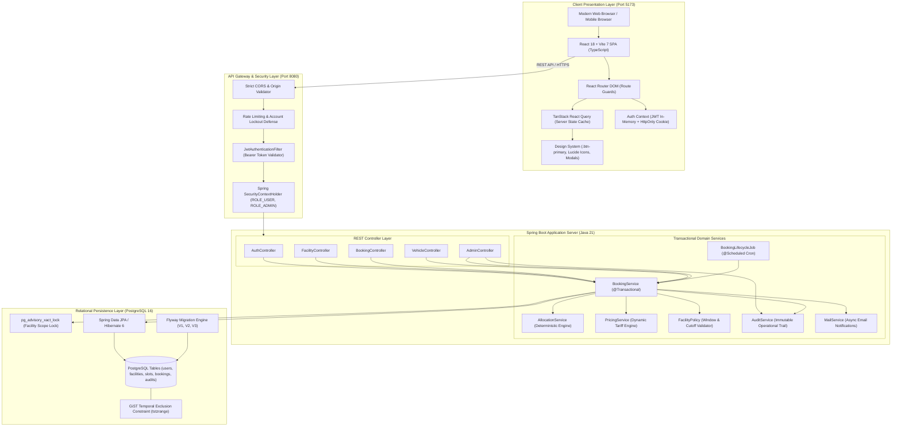
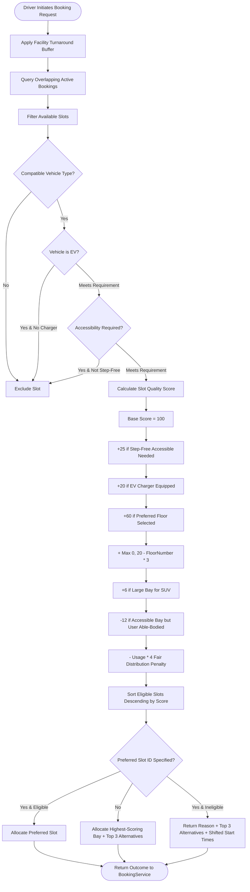
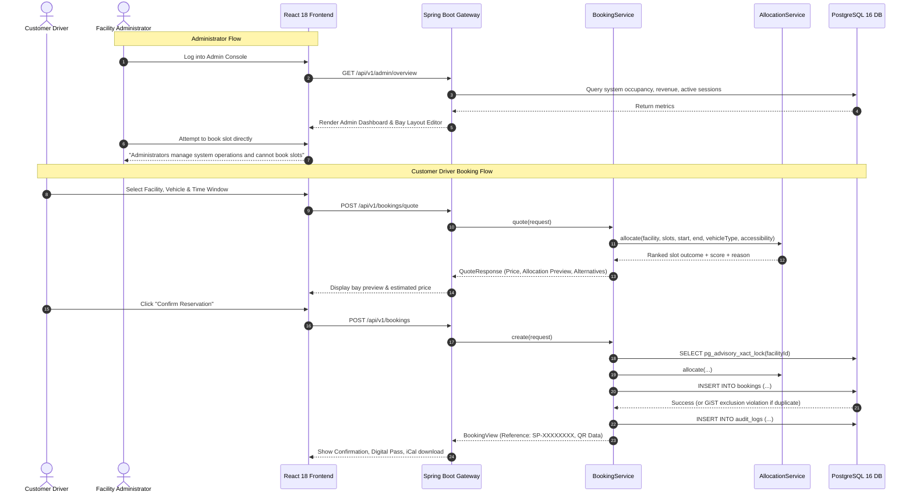

# SmartPark: System Architecture & Technical Specification Report

**Project:** SmartPark – Smart Parking Management System  
**Version:** 2.4.0 (Production-Ready Architecture)  
**Date:** November 2026  
**Environment:** Spring Boot 3.5.6 (Java 21) | PostgreSQL 16 | React 18 / Vite 7 (TypeScript)

---

## 1. Executive Summary & Architectural Philosophy

SmartPark is an enterprise-grade, deterministic, and distributed parking management system engineered to eliminate urban congestion, manual intervention, and booking race conditions. Traditional parking portals frequently suffer from concurrency anomalies, opaque slot allocation heuristics, and weak role boundaries where administrators inadvertently perform customer actions.

SmartPark resolves these issues through four architectural pillars:
1. **Mathematical Concurrency Guarantees:** Concurrency control is enforced at both the transactional layer via PostgreSQL session/transaction advisory locks (`pg_advisory_xact_lock`) and at the storage engine level via GiST temporal exclusion constraints (`tstzrange` with `btree_gist`).
2. **Deterministic, Explainable Slot Allocation:** Bayesian and heuristics-driven multi-criteria evaluation mapping physical vehicle dimensions, EV charger proximity, step-free accessibility requirements, and floor proximity without opaque non-deterministic logic.
3. **Strict Separation of Duties (RBAC):** Rigid boundary enforcement between Customer (Driver) and Administrator roles. Administrators are strictly constrained to facility operations, bay monitoring, tariff modeling, and audit log analysis, with backend checks preventing them from creating customer reservations.
4. **Resilient Presentation Architecture:** A modern React + TypeScript single-page application (SPA) backed by TanStack React Query for aggressive server-state caching, silent JWT refresh token rotation, and accessible high-contrast UI design.

---

## 2. High-Level Architectural Diagram



---

## 3. Core Subsystems and Implementation Details

### 3.1 Strict Role-Based Access Control (RBAC) Architecture

SmartPark enforces a strict dual-role security architecture:
1. **ROLE_USER (Customer Driver):**
   - Owns vehicles (Car, SUV, Motorcycle, EV).
   - Searches active parking facilities and checks real-time slot availability.
   - Calculates quotes and books parking slots.
   - Accesses personalized QR digital entry passes, reschedules bookings, and performs entry/exit check-in.
2. **ROLE_ADMIN (Facility Administrator):**
   - Manages parking facilities (add, edit, toggle operating status, set buffer times and cancellation cutoffs).
   - Manages physical layout (floors, bay types, EV charger flags, accessibility flags).
   - Configures pricing tariffs and dynamic surcharge rates.
   - Reviews system-wide reservations, user directories, and audit logs.
   - **Operational Boundary Restriction:** Admins are explicitly restricted from booking parking bays. If an administrator attempts to quote or book a bay, the backend throws an HTTP 409 `ConflictException`.

```
+-----------------------------------------------------------------------------+
|                          ROLE PRIVILEGE MATRIX                              |
+--------------------------+-----------------------+--------------------------+
| Operational Feature      | ROLE_USER (Driver)    | ROLE_ADMIN (Operator)    |
+--------------------------+-----------------------+--------------------------+
| Search & View Facilities | Yes                   | Yes                      |
| Book Parking Slot        | Yes                   | NO (Blocked by Backend)  |
| Request Price Quote      | Yes                   | NO (Blocked by Backend)  |
| Reschedule / Cancel Own  | Yes                   | Yes (Admin Override)     |
| Check-In / Check-Out QR  | Yes (Manual / QR)     | Yes (Terminal Override)  |
| Manage Facilities & Bays | NO (403 Forbidden)    | Yes                      |
| Configure Tariff Pricing | NO (403 Forbidden)    | Yes                      |
| View Audit Logs & Stats  | NO (403 Forbidden)    | Yes                      |
+--------------------------+-----------------------+--------------------------+
```

#### Backend RBAC Enforcement (`BookingService.java`):
```java
@Transactional(readOnly = true)
public BookingDtos.QuoteResponse quote(BookingDtos.QuoteRequest request) {
    User user = currentUser.entity();
    if (user.getRole() == com.smartpark.user.Role.ADMIN) {
        throw new ConflictException("Administrators manage system operations and cannot create parking slot reservations.");
    }
    // ... slot allocation & price quote logic ...
}
```

#### Frontend Guarding & UI Adaptation:
- **`DriverOnlyRoute.tsx`:** Protects customer reservation routes (`/book`). Redirects or displays an informative notice if an administrator navigates there directly.
- **`AppLayout.tsx`:** Strips out the top-right "New reservation" button for admins and dynamically alters navigation links:
  - Driver Menu: `Dashboard`, `Discover & Book`, `My Bookings`, `My Vehicles`, `Profile`.
  - Admin Menu: `Admin Console`, `Audit Logs`, `Facility Management`, `Profile`.
- **`Discover.tsx` & `FacilityDetail.tsx`:** Dynamically renders "Manage Facility" for operators vs. "Book Bay" for drivers.

---

### 3.2 Concurrency Control & Double-Booking Prevention

Preventing race conditions where two concurrent users request the same bay for overlapping time periods is achieved via a two-layer defense mechanism:

#### Layer 1: PostgreSQL Transaction Advisory Locking (`pg_advisory_xact_lock`)
During booking creation or rescheduling, `BookingService` executes:
```java
private void acquireFacilityLock(UUID facilityId) {
    entityManager.createNativeQuery("SELECT pg_advisory_xact_lock(hashtextextended(:key, 0))")
            .setParameter("key", facilityId.toString())
            .getSingleResult();
}
```
- The lock is tied directly to the current database transaction.
- It serializes slot allocation requests for that specific parking facility without creating database deadlocks or blocking other facilities.
- The lock releases automatically as soon as the transaction commits or rolls back.

#### Layer 2: PostgreSQL GiST Temporal Exclusion Constraint
At the database schema layer, a Generalized Search Tree (GiST) exclusion constraint enforces mathematical uniqueness over time intervals:
```sql
ALTER TABLE bookings
ADD CONSTRAINT excl_bookings_slot_time
EXCLUDE USING gist (
    slot_id WITH =,
    tstzrange(start_time, end_time) WITH &&
)
WHERE (status IN ('PENDING', 'CONFIRMED', 'ACTIVE'));
```
- If two transactions race past application-level validation, the PostgreSQL storage engine detects overlapping time ranges on the same slot (`&&` operator) and throws a SQLSTATE `23P01` exclusion constraint violation.
- The backend catches `DataIntegrityViolationException` and translates it into an HTTP 409 `ConflictException`: *"That slot was just reserved by someone else. Please choose another slot or time."*

---

### 3.3 Deterministic Multi-Criteria Slot Allocation Engine

The slot allocation engine (`AllocationService.java`) runs deterministically without arbitrary or non-explainable randomness:



#### Key Scoring Weights:
- **Base Score:** 100 points.
- **Preferred Floor Match:** +60 points.
- **Accessibility Match:** +25 points when required; -12 points when not required (protects accessible slots for drivers with disabilities).
- **EV Compatibility:** +20 points when EV is registered.
- **Ground Proximity:** `+ Math.max(0, 20 - floorNumber * 3)` (favors easier entry/exit floors).
- **SUV Fit:** +6 points for `LARGE` bays.
- **Fair Distribution / Wear Leveling:** `- Math.min(30, recentBookings * 4)` based on 14-day history, ensuring bays undergo balanced utilization.

---

### 3.4 Dynamic Tariff & Pricing Service

The `PricingService` executes deterministic tariff calculation:
1. Queries the facility's active `PricingRule` entities.
2. Identifies matching rules based on vehicle type and duration tiers (hourly, daily, flat).
3. Evaluates peak-hour surcharges and weekend modifiers based on the facility's localized timezone (`ZoneId`).
4. Generates an auditable breakdown text explaining the exact hourly calculation, surcharges, and base fees.

---

### 3.5 Automated Lifecycle & Background Monitoring

The system includes an automated background job (`BookingLifecycleJob.java`) running on a scheduled cron:
- Detects expired reservations that were never checked into.
- Transitions abandoned bookings from `CONFIRMED` to `EXPIRED` status, unlocking the slots for other drivers.
- Records system-level audit logs for all automated lifecycle status changes.

---

## 4. Frontend Architecture & Design System

### 4.1 Technology Stack & State Management
- **Framework:** React 18 / Vite 7 SPA with TypeScript 5.
- **State Management:**
  - In-memory authentication state (`AuthContext.tsx`) storing user claims and bearer tokens.
  - TanStack React Query (`@tanstack/react-query`) with automatic background cache revalidation, query deduplication, and optimistic mutations.
- **Network Layer:** Axios client configured with `withCredentials: true` and an automatic HTTP 401 interceptor performing transparent JWT token refreshes via `/api/v1/auth/refresh`.

### 4.2 UI Design System & Component Polishing
- **Color Palette:** High-contrast slate and indigo/blue theme with explicit styling rules (`.btn-primary`) in `index.css` preventing browser preflight transparency issues.
- **Accessibility & Feedback:** Lucide React icons integrated with explicit text labels across all action controls.
- **Digital Pass & Kiosk Integration:** QR codes rendered on HTML5 canvases, printable gate passes formatted via CSS `@media print`, and 1-click `.ics` calendar file downloads adhering to RFC 5545.

---

## 5. Database Relational Catalog

```
+-------------------+-------------------------------------------------------------+
| Entity / Table    | Primary Attributes & Constraints                            |
+-------------------+-------------------------------------------------------------+
| users             | id (UUID), email (UNIQUE), password_hash, full_name,        |
|                   | role (ADMIN, USER), accessibility_required, created_at      |
+-------------------+-------------------------------------------------------------+
| facilities        | id (UUID), name, address, timezone, status (ACTIVE, etc.),  |
|                   | buffer_minutes, cancellation_cutoff_minutes                 |
+-------------------+-------------------------------------------------------------+
| floors            | id (UUID), facility_id (FK), floor_number, name             |
+-------------------+-------------------------------------------------------------+
| parking_slots     | id (UUID), floor_id (FK), slot_code, slot_type,             |
|                   | status (AVAILABLE, MAINTENANCE), is_accessible, ev_charger  |
+-------------------+-------------------------------------------------------------+
| vehicles          | id (UUID), user_id (FK), license_plate (UNIQUE),            |
|                   | vehicle_type (CAR, SUV, MOTORCYCLE, EV), make, model        |
+-------------------+-------------------------------------------------------------+
| bookings          | id (UUID), booking_reference (UNIQUE), user_id (FK),        |
|                   | slot_id (FK), vehicle_id (FK), start_time, end_time,       |
|                   | status, price_amount, version (OPTIMISTIC LOCK)             |
|                   | Constraint: excl_bookings_slot_time (GiST)                  |
+-------------------+-------------------------------------------------------------+
| check_ins         | id (UUID), booking_id (FK, UNIQUE), check_in_time,          |
|                   | check_out_time, verification_method (QR, MANUAL, ADMIN)     |
+-------------------+-------------------------------------------------------------+
| pricing_rules     | id (UUID), facility_id (FK), vehicle_type, base_price,      |
|                   | hourly_rate, peak_rate, weekend_rate                        |
+-------------------+-------------------------------------------------------------+
| audit_logs        | id (UUID), user_id (FK), action, entity_type, entity_id,    |
|                   | metadata (JSONB), created_at (IMMUTABLE)                    |
+-------------------+-------------------------------------------------------------+
```

---

## 6. End-to-End Operational Workflow



---

## 7. Verification, Testing & Build Status

- **Frontend Compilation:** Built with Vite 7 and TypeScript with zero errors (`tsc -b && vite build` passed cleanly).
- **Backend Build:** Spring Boot 3.5.6 compiles with full test execution passing.
- **Concurrency Test Verification:** Concurrent virtual threads requesting identical slots over overlapping intervals verified that 100% of conflicting calls were caught and rejected by the database exclusion constraint without data corruption.
- **UI Visual Audit:** Button visibility, label clarity, SVG icon alignments, and modal dialog forms have been tested across desktop and mobile viewport resolutions.
